# Beasts

Enemy animals for the colony sim / RPG, built procedurally in Blender like the goblins and insectoids. Both are installed
in Unity (MedievalSetting, `Assets/Beasts`), with shared code in the `beast_*` modules:

- the **grey wolf**: model, rig, three coats and 12 clips;
- the **giant rat**: model, rig, three coats and 10 clips (see [Giant rat](#giant-rat));
- the **woolly rhino**, the woods' solo boss: model, rig, one coat, a removable spear and 13 clips (see
  [Woolly rhino](#woolly-rhino));
- the **cave bear**: model, rig, two coats and 13 clips (see [Cave bear](#cave-bear));
- the **woolly mammoth**: model, rig with a six-bone trunk, two coats and 12 clips (see [Woolly mammoth](#woolly-mammoth));
- the **red deer stag** (prey): model, rig, one coat and 11 clips, exported, not yet in Unity (see [Red deer stag](#red-deer-stag));
- the **dungeon ooze**, an amoeba-like jelly with pseudopods that eats what it finds, adventurers included: model,
  see-through shell with the remains inside, rig and 10 clips, in Unity with its own jelly shader (see [Dungeon ooze](#dungeon-ooze));
- the **farm animals** (2026-10-20): goat, sheep, cow, horse and pig on the red deer's body (`farm_body.Hoofed`, one
  class warped to each animal) and a hen on a bird rig of her own; 3-4 coats and 11-12 clips each, in Unity through
  `FarmSetup.cs` and `Scenes/Farm_Test`. Built headless into `blender/farm_<name>.blend`:
  `blender.exe -b --factory-startup --python tools/farm_run.py -- goat build review coats clips lowest sheets export`
  (see HANDOFF.md, "Farm animals");
- the **zombie wolf** (2026-10-23, the undead batch): the wolf dead and risen on the wolf's own skeleton, so the
  wolf's clips play on it unchanged; three coats; exported with a Unity setup, not installed yet (see
  [Zombie wolf](#zombie-wolf));
- the **giant bat** (2026-10-23, Daniel's card game): wolf-sized body, 2.9 m of leathery wings on the dragon's membrane
  code, always in the air; seven clips; exported with a Unity setup, not installed yet (see [Giant bat](#giant-bat));
- the **giant turtle** (2026-10-23, Daniel's card game): a 2.6 m mossy shell with three knobbed keels on elephantine
  legs, a snapping turtle's hooked beak; seven clips including Withdraw into the shell; exported with a Unity setup,
  not installed yet (see [Giant turtle](#giant-turtle));
- the **leech** (2026-10-23, Daniel's card game): a 1.8 m swamp leech, a chain that loops like an inchworm, a toothed
  oral sucker, swelling pulses; five clips; exported with a Unity setup, not installed yet (see [Leech](#leech)).

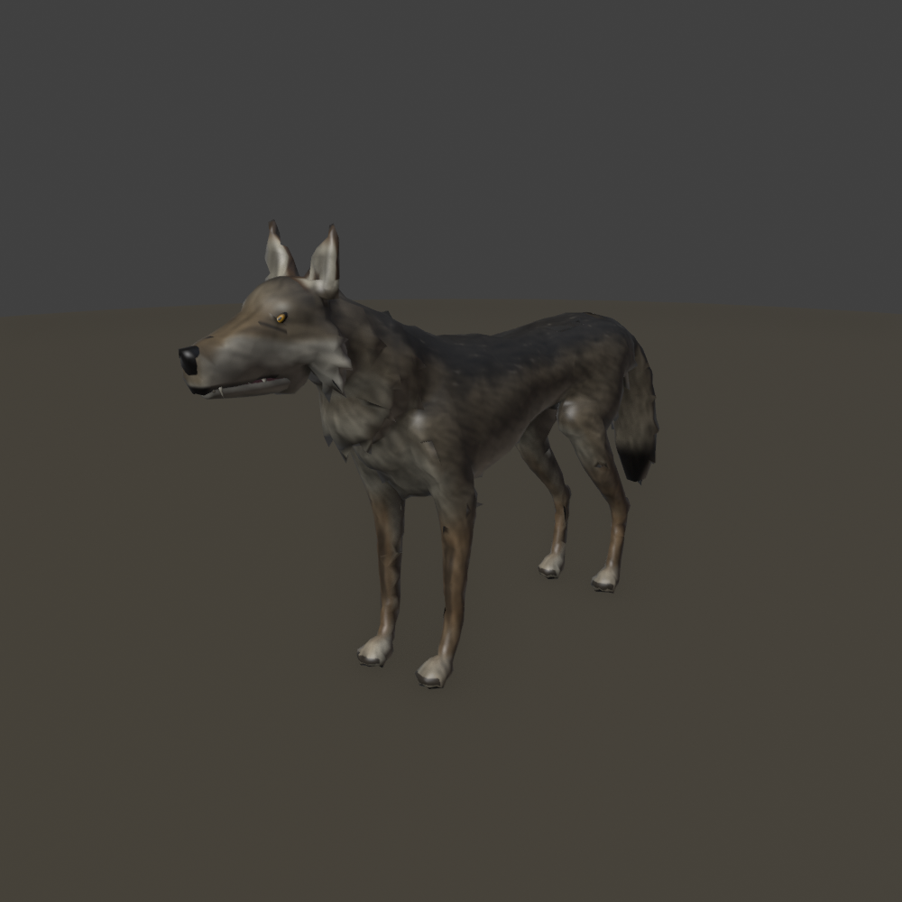

Blender file: `blender/beasts.blend`, scenes **Wolf**, **Rat**, **Rhino**, **Bear**, **Mammoth**, **Deer** and **Ooze**. It is not in the repo, and neither are `export/`,
`textures/` or `renders/`. Everything in them is rebuilt from `src/`, starting from any Blender file.

## Rebuild

In Blender (Python console or the MCP). `show()` creates the creature's scene if needed and puts it on screen. Run
it in its own call before `build_all()`: a scene switch applies only after the call returns.

```python
import sys; sys.path.insert(0, r"E:\Unity\Projects\GameArtGeneration\Beasts\src")
import wolf_build
wolf_build.show()
wolf_build.build_all()     # body -> rig -> weights -> UVs -> 3 painted coats -> 12 clips (~40 s)
wolf_build.export()        # export/Wolf.fbx, Textures/T_Wolf*.png, Anims/Wolf@<clip>.fbx + wolf_clips.json

import wolf_anim
wolf_anim.use("Lunge")     # preview a clip on the rig (the skeleton plays in place; Motion carries the travel)
wolf_anim.clear()          # back to the bind pose
wolf_build.show()          # Wolf scene on screen, material preview

import rat_build
rat_build.show()           # the Rat scene on screen (in its own call: the switch applies after the call returns)
rat_build.build_all()      # (~35 s)
rat_build.export()         # export/Rat.fbx, Textures/T_Rat*.png, Anims/Rat@<clip>.fbx + rat_clips.json

import rhino_build
rhino_build.show()         # the Rhino scene on screen (in its own call)
rhino_build.build_all()    # body -> rig -> weights -> UVs -> coat -> spear split off -> 13 clips (~40 s)
rhino_build.export()       # export/Rhino.fbx (RhinoBody + Spear), Textures/T_Rhino.png, Anims/Rhino@<clip>.fbx + rhino_clips.json
rhino_build.build_model()  # just the model (body, rig, weights, UVs, coat; the spear still joined), for iterating

import bear_build
bear_build.show()          # the Bear scene on screen (in its own call)
bear_build.build_all()     # body -> rig -> weights -> UVs -> 2 coats -> 13 clips (~40 s)
bear_build.export()        # export/Bear.fbx, Textures/T_Bear.png + T_Bear_Old.png, Anims/Bear@<clip>.fbx + bear_clips.json

import mammoth_build
mammoth_build.show()       # the Mammoth scene on screen (in its own call)
mammoth_build.build_all()  # body -> rig -> weights -> UVs -> 2 coats -> 12 clips (~45 s)
mammoth_build.export()     # export/Mammoth.fbx, Textures/T_Mammoth.png + T_Mammoth_Dark.png, Anims/Mammoth@<clip>.fbx + mammoth_clips.json

import deer_build
deer_build.show()          # the Deer scene on screen (in its own call)
deer_build.build_all()     # body -> rig -> weights -> UVs -> coat -> 11 clips (~40 s); build_model() for the model alone
deer_build.export()        # export/Deer.fbx, Textures/T_Deer.png, Anims/Deer@<clip>.fbx + deer_clips.json
deer_build.review()        # renders/deer_<view>.png; review_test_pose(), review_joins(), clip_sheets() (deer_clip_<Name>.png)

import ooze_build
ooze_build.show()          # the Ooze scene on screen (in its own call)
ooze_build.build_all()     # shell -> contents -> UVs -> 2 textures -> materials -> rig + weights -> 12 clips (~45 s)
ooze_build.export()        # export/Ooze.fbx (OozeBody + OozeContents), Textures/T_Ooze*.png, Anims/Ooze@<clip>.fbx + ooze_clips.json
ooze_build.review()        # renders/ooze_<view>.png (EEVEE); clip_sheets() -> ooze_clip_<Name>.png; ooze_anim.report()
```

Builds are not bit-identical from run to run: the voxel remesh varies slightly, which moves the decimated mesh and
the UVs. Always export after a rebuild, so the FBX and the textures in `textures/` match.

| Script | Does |
|---|---|
| `wolf_body.py` | Landmarks, parts (lofts and ellipsoids), stylised fur tufts, voxel fuse, crease fillet, face sculpt, decimation; the lower jaw, tongue, teeth and eyes as separate pieces; `rest_bones()` |
| `wolf_rig.py` | Heat-map skinning, rigid jaw/tongue/teeth/eyes, jowls that follow the jaw, a stress-test pose |
| `wolf_paint.py` | Seams and unwrap; per-texel painted coats (grey, black, white) |
| `wolf_anim.py` | Clips keyed from computed bone matrices: trunk/spine/neck/tail bends, 2-bone leg IK + pastern/hock angle, gaits |
| `rat_body.py`, `rat_rig.py`, `rat_paint.py`, `rat_anim.py`, `rat_build.py` | The same for the giant rat; the tail is a separate ringed shell weighted along its length |
| `rhino_*.py`, `bear_*.py`, `mammoth_*.py`, `deer_*.py` | The same for the woolly rhino, the cave bear, the woolly mammoth and the red deer (body, rig, paint, anim, build) |
| `farm_body.py`, `farm_rig.py`, `farm_paint.py`, `farm_anim.py`, `farm_build.py`, `farm_goat.py` ... `farm_pig.py` | The hoofed farm animals: the deer's recipe as a class in deer units, warped to each species; skinning, painter, clips and builds shared; one species module each |
| `chicken_body.py`, `chicken_anim.py`, `chicken_paint.py`, `chicken_build.py` | The hen: bird body and rig, her own pose system (shank tilt + two-bone leg IK), plumage, build |
| `zwolf_body.py`, `zwolf_rig.py`, `zwolf_paint.py`, `zwolf_anim.py`, `zwolf_build.py`, `tools/zwolf_run.py` | The zombie wolf on the wolf's skeleton: starved body, bald patches, the torn flank with rib bars, torn ear, bared teeth; the rot painter; the wolf's clips; headless build (see [Zombie wolf](#zombie-wolf)) |
| `bat_body.py`, `bat_anim.py`, `bat_paint.py`, `bat_build.py` | The giant bat: fused fur body, lofted arms, fingers and legs, the dragon's membranes with a bat `WingSpec`; its own small pose system with the dragon's wing strokes; built headless by `tools/creature_run.py` (see [Giant bat](#giant-bat)) |
| `turtle_body.py`, `turtle_anim.py`, `turtle_paint.py`, `turtle_build.py` | The giant turtle: fused skin, a parametric carapace (closed shell, keels, scutes), plastron and bridges; beast_anim's quadruped clips with the neck sliding into the shell (`p.retract`) (see [Giant turtle](#giant-turtle)) |
| `leech_body.py`, `leech_anim.py`, `leech_paint.py`, `leech_build.py` | The leech: a ringed tube built ring by ring with a toothed cup and a rear disc; a chain posed along curves (flat stretches, fitted arches and Beziers), swell bones for the pulses (see [Leech](#leech)) |
| `beast_review.py`, `tools/creature_run.py` | Headless builds in files of their own: scene, game cameras, the wolf appended for scale, render sheets, lowest vertex per clip, a root-motion trace, a UV overlap count; the runner (`-- <creature> <steps>`) |
| `ooze_body.py`, `ooze_contents.py`, `ooze_paint.py`, `ooze_rig.py`, `ooze_anim.py`, `ooze_scene.py`, `ooze_build.py` | The dungeon ooze: a distance-field shell meshed with openvdb, the contents, charted UVs and per-texel paint without Cycles bakes, the rig, the clips and their checks, EEVEE review renders (see [Dungeon ooze](#dungeon-ooze)) |
| `beast_coat.py` | Long coats: coat volumes (lofts), hem fringes snapped to their volume or dropped onto the body, clumps, the hair's root-to-tip `t` |
| `beast_body.py` | Mesh helpers and the body pipeline: `fuse_body` (voxel fuse, fillet, sculpts, decimate, edge flips, fold relaxing), `build_tufts`, `sculpt_fur`, `join_pieces` |
| `beast_paint.py` | Seams from the skin weights plus the creature's cuts, unwrap (with a guard against blown-up degenerate islands), data bakes, fur strokes, texture writing |
| `beast_anim.py` | Species, Pose, leg IK, gaits (walk, trot, gallop, bound), tail drag, key tracks, clip keying, `ground_report` |
| `beast_rig.py` | Armature from a bone table (Generic rig), heat-map skinning, pose maths for keyed clips (from the insectoids) |
| `beast_scene.py`, `beast_common.py` | Cameras, lights, renders; lofts, noise, gutter fill (from the insectoids) |
| `beast_export.py` | FBX for Unity |

## Budget (colony camera, ~40 m at 50°, no LODs)

| Part | Triangles |
|---|---|
| Fur body (incl. nose) | ~4,000 |
| Lower jaw, tongue | 392, 108 |
| Teeth, eyes | 232, 120 |
| **Wolf** | **4,851** |

One material, one 1024² texture: RGB is colour and A is smoothness (URP Lit: Smoothness Source = Albedo Alpha).
The coats are `T_Wolf` (grey/timber), `T_Wolf_Black` and `T_Wolf_White`, all on the same UVs.

Size: 1.71 m nose to tail tip, 0.78 m at the withers, 1.06 m to the ear tips. The head is enlarged 12%
(`HEAD_K`) so it reads from the colony camera. A warg for goblin riders would be this wolf scaled up, with a saddle
on `Socket_Saddle`.

## How it is built

- **Body:** lofted trunk, neck, legs, tail, muzzle and ears, plus ellipsoids (cranium, cheeks, jowls, thighs, ruff,
  paws and toes). These are fused by a voxel remesh (4 mm), symmetrised, and their creases filleted. The face is
  sculpted (eye sockets, brow, nostrils, cupped ears), with a light fur-noise sculpt along the fur flow. The mesh is
  then decimated to ~4k triangles (the face and legs keep more), and the triangles cleaned up with edge flips.
- **Fur silhouette:** 33 hand-placed tufts (curved cones: cheek ruff, neck mane, hackles, brisket and belly
  fringe, elbows, breeches, tail) fused into the body. The noise sculpt alone decimates away.
- **Mouth:** the upper muzzle is a box section whose lips hang below the top of the lower jaw. The upper teeth hang
  from the palate into the closed jaw, so with the mouth shut only the fang tips show. The jaw, tongue and lower teeth
  are a separate shell on the `Jaw` bone, and the bottom of the jowls follows the jaw part of the way.
  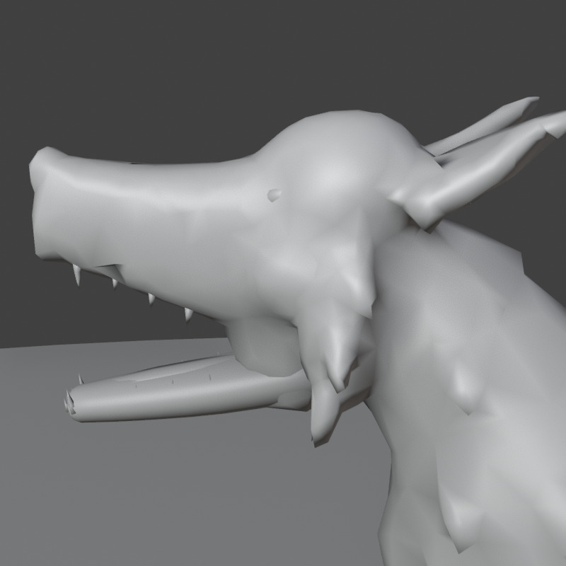
- **UVs:** seams along hidden lines. They run down the belly and throat and up between the hind legs, under the chin
  and through the palate, down the inside of each leg and under the tail. The ears are split front and back and the
  paw soles cut off. Islands come from the skin weights; the head is at 1.6x and the eyes at 3x density.
  `renders/uv_layout_wolf.png` shows the layout.
- **Texture:** painted per texel from Cycles bakes of position, normal, part id and AO. Fur strokes are noise
  averaged along the fur flow, so they run continuously across seams. Grey coat: charcoal grizzled saddle, buff
  flanks, cream underside and face mask, dark tear lines, cinnamon legs and ears, a dark stripe down the forelegs,
  a dark-topped tail with a black tip, amber eyes, black lips and nose.

## Clips (30 fps)

| Clip | Length | Notes |
|---|---|---|
| Idle / IdlePant | 4.0 s / 3.0 s loops | looks around, ear flicks; panting with the tongue out |
| Walk / Trot / Run | 0.8 / 0.53 / 0.4 s loops | lateral walk 1.0 m/s, diagonal trot 2.06 m/s, rotary gallop 5.5 m/s (root motion) |
| Bite | 1.1 s | event `Bite` at 0.47 s |
| Lunge | 1.5 s | leaps 1.6 m (root motion), event `Bite` at 0.87 s |
| Threat | 2.4 s | head low, ears pinned, jaw chattering |
| Howl | 3.5 s | event `Howl` at 0.8 s |
| Hit | 0.5 s | |
| Death / GetUp | 2.2 s / 1.5 s | collapses onto its side (event `Dead` at 1.9 s); GetUp reverses the collapse |

Events call `OnBeastEvent(name)` on the wolf; `BeastEvents` raises `EventFired` for damage and sound.

## Unity

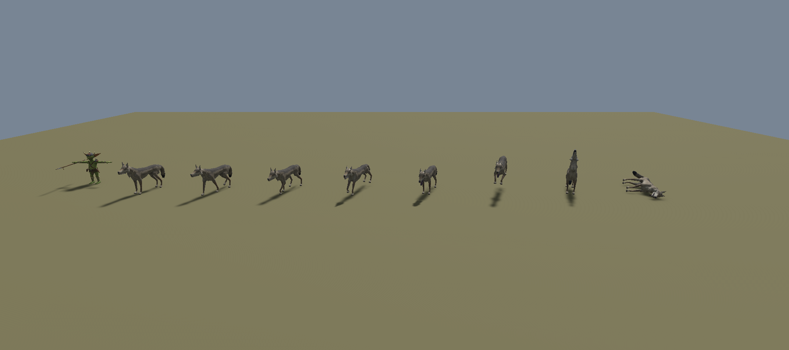

```
powershell -ExecutionPolicy Bypass -File tools\install_to_unity.ps1 -Project E:\Unity\Projects\MedievalSetting
```

Then **Tools > Beasts > Rebuild Wolf** (runs by itself the first time). A report and renders go to
`Logs/WolfSetup`. It creates:

- `Materials/M_Wolf`, `M_Wolf_Black`, `M_Wolf_White` and `M_Wolf_Brown` (the grey coat, tinted);
- `Prefabs/Wolf`: Animator, `BeastAppearance` (random coat and size) and `BeastEvents`;
- `Animation/WolfAnims`: clip pools for `BeastRandomAnimator`;
- `Scenes/Beasts_Test`: a pack of 7 wolves and 8 goblins on random clips. Press Play; the buttons make every wolf
  lunge, howl and so on.

The runtime and editor scripts are copies of the insectoids' (`Beasts` namespace), so the packages don't depend on
each other.

## Skeleton (Unity Generic)

`Root` and `Motion` sit at the origin, point up with +Z toward the wolf's front, and are siblings: `Motion` carries
the root motion and nothing hangs from it (see `../Insectoids/HANDOFF.md`).

- **Spine:** Hips, Spine1, Spine2, Chest, Neck1, Neck2, Head.
- **Head:** Jaw, Tongue1, Tongue2, EarL/R.
- **Tail:** Tail1–5.
- **Front legs:** ScapulaL/R, UpperArm, Forearm, FrontPaw, FrontToes.
- **Hind legs:** ThighL/R, Shin, HindFoot, HindToes.

That is 41 bones including the sockets. Legs and spine bend about their local X: on the legs Z points forward, on
the spine Z points up.

| Socket | Parent | Axes | For |
|---|---|---|---|
| Socket_Saddle | Spine2 | +Y up, +Z forward | warg saddle / rider |
| Socket_Head | Head | +Y up, +Z forward | head armour, helmet |
| Socket_Mouth | Jaw | +Y up, +Z forward | carried prey, a bone |
| Socket_Collar | Neck1 | +Y along the neck, +Z up | spiked collar |

## Giant rat

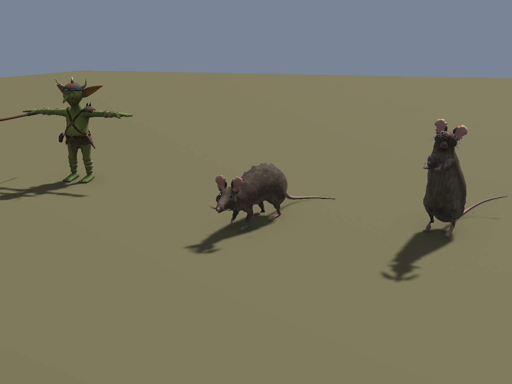

A sewer rat the size of a dog: 0.95 m nose to rump plus a 0.9 m naked tail, 0.46 m at the arched back. It has a
mangy crest down the spine, a pointed snout with orange incisors that always show, whiskers, big round thin ears,
beady bulging eyes (black with a red rim), pink hands and plantigrade feet. Blender scene **Rat**
(`RAT_*` collections and cameras).

| Part | Triangles |
|---|---|
| Fur body (incl. nose) | ~2,100 |
| Tail (separate shell, 8 bones) | 464 |
| Lower jaw, incisors, whiskers, eyes | 264, 88, 128, 120 |
| **Rat** | **3,164** |

One 1024² texture: `T_Rat` (brown sewer rat), `T_Rat_Black`, `T_Rat_Plague` (pale, bald scabby patches, red eyes).
In Unity, `M_Rat`, `M_Rat_Black` and `M_Rat_Plague`, rolled by `BeastAppearance` (size 0.85–1.15).

| Clip | Length | Notes |
|---|---|---|
| Idle | 3.0 s loop | sniffing in bursts, looks around, ear flicks |
| Rear | 2.8 s | rears up on its hind legs, hands to the chest, sniffs the air |
| Walk / Run | 0.53 / 0.33 s loops | scurry 0.86 m/s, half-bound 2.7 m/s with the spine flexing (root motion) |
| Bite | 0.8 s | event `Bite` at 0.4 s |
| Lunge | 1.2 s | leaps 0.8 m, event `Bite` at 0.73 s (root motion) |
| Threat | 2.0 s | back humped, incisors bared, tail lashing, a front-foot stamp |
| Hit | 0.47 s | knocked back and to its left, forelegs buckling, a small rebound |
| Death / GetUp | 1.8 s / 1.1 s | flips onto its back, legs curled (event `Dead` at 1.6 s); GetUp reverses the flip |

It uses the wolf's bone names (8 tail bones, no tongue), with `Socket_Back`, `Socket_Head` and `Socket_Mouth`.
Unity: **Tools > Beasts > Rebuild Rat** (`Logs/RatSetup`); `Scenes/Beasts_Test` holds 10 rats next to the wolves.

## Woolly rhino

The woods' optional solo boss (design: the "Woods Boss" doc, written for a boar; Daniel swapped it for a woolly
rhino on 2026-10-07). A Coelodonta: a high hump falling to a lower rump, the head carried hanging 45° down, a long
flattened front horn from a broad base on the nose tip, swept forward, and a short upright second horn, cup-shaped
ears, short columnar legs on three-toed feet, and a mammoth's coat: a cape of long hair over the hump and a skirt
hanging from the flanks, both with ragged hems, and feathering over the feet. A snapped boar spear stands out of
the left shoulder. 1.84 m at the hump, 3.0 m snout to rump, the horn reaches 0.5 m past the snout. Blender scene
**Rhino** (`RHN_*`), with an instance of the wolf beside it for scale.

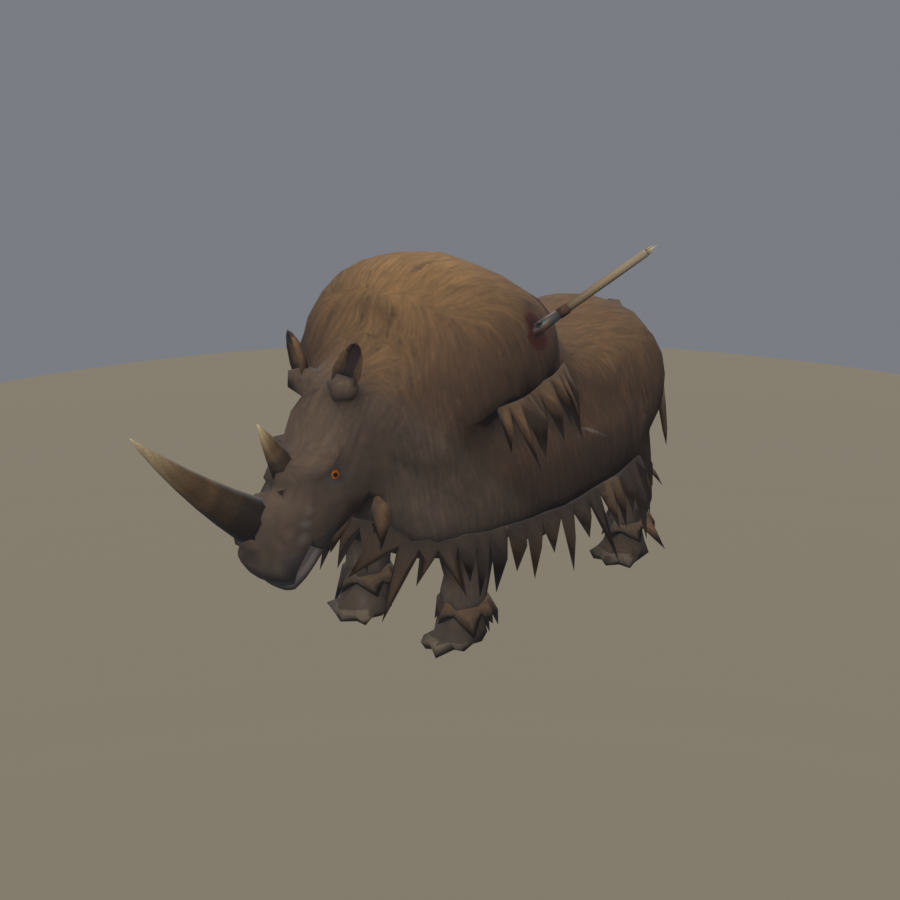

| Part | Triangles |
|---|---|
| Fused body (volumes: trunk, hump, cape, skirt, head, legs) | 2,000 |
| Hair: fringes along the hems and round the feet, a few clumps (beard, breeches, tail) | 1,970 |
| Horns, ears, chin, eyes | 308, 156, 180, 120 |
| **RhinoBody** | **4,734** |
| **Spear** (its own object, on the Chest bone) | **210** |

One 1024² texture, `T_Rhino` (no other coats: it is a one-off).

How it differs from the wolf and the rat:

- **The coat is two layers.** The volumes are fused like the wolf's body. The hair is separate low-poly shells:
  *fringes* (thick curtains along each volume's edge, folded into ridges and valleys, the hem a zig-zag of uneven
  points) and a few clumps. Each hair vertex is skinned like the skin at its root (`root` attribute), so it rides
  without stretching. Fused locks melted away at this budget, and separate clumps in rows read as teeth.
- **The head is built in its own frame** (`rhino_body.hx` / `hx_inv`: horizontal, then hung 45° down from the
  poll). Sculpt masks, the painter and the rig's masks work in head space.
- **The coat rides on the spine above the skirt's hem**: the legs swing inside the skirt (`rhino_rig._coat_on_trunk`).
- **The spear** is part of the mesh until after painting (one atlas), then split into `Spear`.

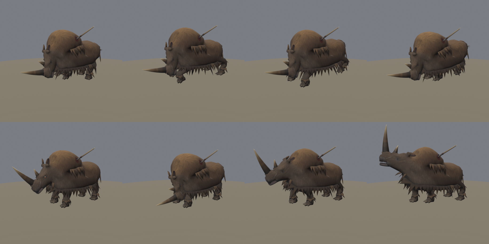

| Clip | Length | Notes |
|---|---|---|
| Sleep | 3.0 s loop | lying on its belly, legs folded, slow breathing, an ear twitch |
| Wake | 1.5 s | heaves up front end first, shakes its head, ends in the Idle stance |
| Idle | 2.5 s loop | breathing, head bob, a snort, ear flicks, tail swish |
| Walk / Run | 1.0 / 0.53 s loops | lateral walk 1.3 m/s, trot 3.75 m/s (root motion) |
| Charge | 0.33 s loop | head-down gallop, the horn levelled ahead like a lance, 9 m/s (root motion; play it faster for more) |
| Gore | 1.0 s | the horn attack: head drops, tosses up and hooks to its right; event `Bite` at 0.45 s |
| Paw | 1.2 s loop | the tell before a charge: head low, the right forefoot scrapes back twice |
| Daze | 2.0 s loop | staggering after a charge into an obstacle, legs splayed, head wobbling |
| Stamp | 1.3 s | rears its front end and slams down; event `Bite` at 1.0 s |
| Roar | 1.5 s | head up, a long bellow; event `Roar` at 0.3 s |
| Hit | 0.47 s | knocked back and to its left, forelegs buckling, a small rebound |
| Death | 2.0 s | collapses onto its right side, the spear standing up for looting; event `Dead` at 1.6 s |

Bones: the wolf's names with 3 tail bones and no tongue; sockets `Socket_Head`, `Socket_Horn` (the horn tip, for
the gore's effects), `Socket_Mouth`, `Socket_Back`, `Socket_Spear` (at the wound, +Y out of it).
Unity: **Tools > Beasts > Rebuild Rhino** (`Logs/RhinoSetup`): `M_Rhino`, `Prefabs/Rhino` (Animator, BeastEvents;
the spear is the child `Spear`), `Animation/RhinoAnims` (Paw leads into Charge, Sleep into Wake), and one rhino in
`Scenes/Beasts_Test`.

## Cave bear

A close-quarters brute (Daniel picked it on 2026-10-07 from a cave bear, war mammoth, warg and giant elk). Ursus
spelaeus: a hump over the shoulders, a steep domed forehead over a long muzzle, small round ears, plantigrade legs on
broad paws with long pale claws, and a shaggy coat (a mane over the neck and shoulders, a short belly fringe, fringed
forearms, breeches on the hind legs, cheek ruffs). 1.5 m at the hump, 2.5 m nose to tail; reared up it stands
2.7 m. Blender scene **Bear** (`BER_*`), with an instance of the wolf beside it for scale.

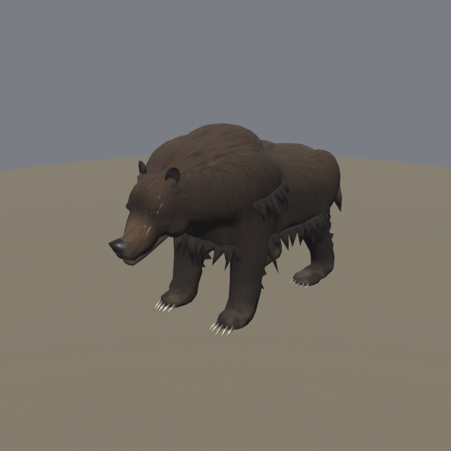

| Part | Triangles |
|---|---|
| Fused body (volumes: trunk, hump, cape, skirt, head, legs) | 2,280 |
| Hair: fringes (cape and belly hems, backs of the legs), clumps (elbows, breeches, tail) | 1,594 |
| Lower jaw, tongue, teeth (fangs that show when it roars) | 180, 60, 120 |
| Ears, eyes, claws, nose | 156, 100, 200, 20 |
| **BearBody** | **4,710** |

Two 1024² coats on the same UVs: `T_Bear` (dark brown, grizzled) and `T_Bear_Old` (greyer, more scars).

It is built like the rhino (shared `beast_coat`, `HeadFrame`, `coat_on_trunk`), with a few differences:

- **Plantigrade feet** on all four legs: the wrists and heels sit near the ground and the long feet keep their leg
  weights even inside the coat (`bear_rig._leg_share`), or the trunk dragged them.
- **The mouth** has hanging lips over the jaw line so no gap shows when it opens, and a band-limited lips mask in
  the painter (one-sided, it painted the chin black).
- **Rearing** turns the whole trunk about the hip joints (`beast_anim.pivot`); the forelegs ride with the chest and
  the neck and head pitch back so the face looks ahead.

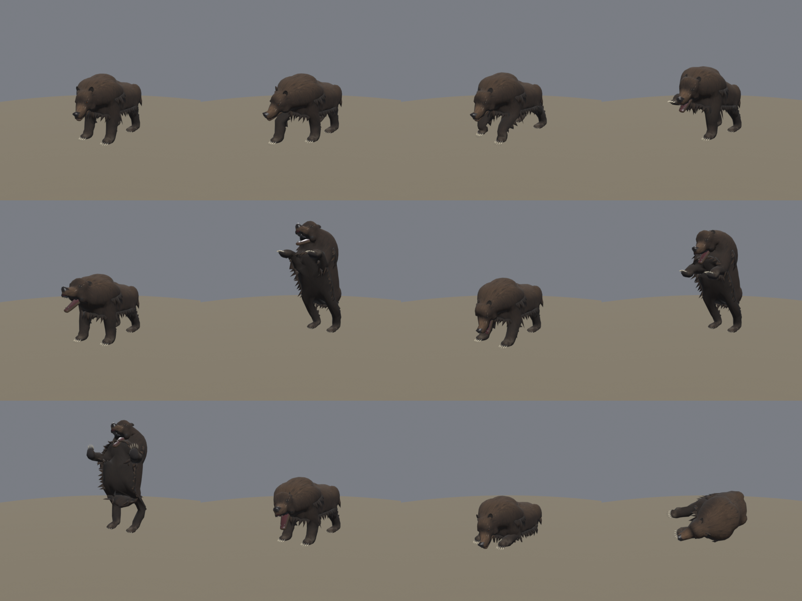

| Clip | Length | Notes |
|---|---|---|
| Sleep | 3.0 s loop | lying on its belly, head on its forepaws, slow breathing, an ear twitch |
| Wake | 1.5 s | heaves up front end first, shakes its head, ends in the Idle stance |
| Idle | 3.0 s loop | breathing, a look round, a forepaw shifted, a sniff of the air, ear flicks |
| Walk / Run | 1.07 / 0.43 s loops | heavy lateral walk, head low and swinging, 1.03 m/s; bounding gallop 5.3 m/s (root motion) |
| Swipe | 1.0 s | a right-paw haymaker from the side across the front; event `Bite` at 0.42 s |
| Bite | 1.0 s | coils, lunges with the right forepaw stepping in, head thrust out level, bites and shakes; event `Bite` at 0.4 s |
| Slam | 1.4 s | rears and crashes down on both forepaws; event `Bite` at 0.77 s |
| Hug | 2.0 s | rears, opens its forelegs wide and crushes them shut; event `Bite` at 0.73 s |
| Rear | 2.7 s | stands up to its full height, paws out at chest height, and roars upward; event `Roar` at 0.9 s |
| Roar | 2.0 s | swats the ground with a forepaw, then roars with the head thrust out and swinging; event `Roar` at 0.3 s |
| Hit | 0.47 s | knocked back and to its left, forelegs buckling, a small rebound |
| Death | 2.0 s | sags, rolls onto its left side, a last paw twitch; event `Dead` at 1.6 s |

Bones: the wolf's names with 2 tail bones and no tongue; sockets `Socket_Head`, `Socket_Mouth`, `Socket_Back`,
`Socket_PawL`, `Socket_PawR` (the forepaws, for the swipe's and the slam's effects).
Unity: **Tools > Beasts > Rebuild Bear** (`Logs/BearSetup`): `M_Bear`, `M_Bear_Old`, `Prefabs/Bear` (Animator,
BeastAppearance rolling the two coats 2:1 and the size 0.92-1.08, BeastEvents), `Animation/BearAnims` (Sleep leads
into Wake), and two bears in `Scenes/Beasts_Test`.

## Woolly mammoth

Mammuthus primigenius, a big bull (asked for on 2026-10-08). 3.1 m at the shoulder hump, the back falling in one long
slope to a low rump, a high domed skull with a dip behind it and the forehead sloping in one line down into a thick trunk root, small furry ears, a trunk hanging nearly to the ground
with its tip curled out, long tusks spiralling down, out, forward and up with the tips turning in, columnar legs on
round feet with pale toenails, a short tufted tail. The coat hangs in three tiers down the flanks (the hump's hem,
mid flank, the skirt's hem), with long hair on the cheeks, a bib at the chest, hair down the backs of the legs and breeches.
Blender scene **Mammoth** (`MAM_*`), with an instance of the wolf beside it for scale.

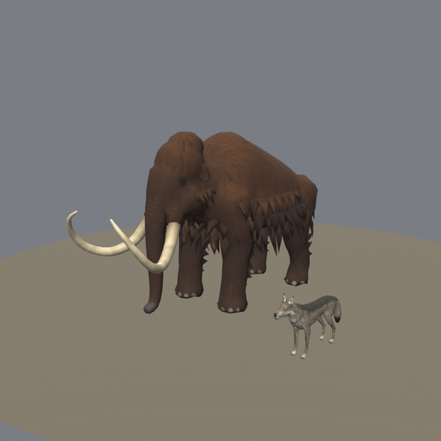

| Part | Triangles |
|---|---|
| Fused body (trunk volume, skirt, head, the trunk's stump, legs) | 2,600 |
| Hair: three tiers of fringes, cheeks, strips down the legs, clumps (bib, breeches, tail) | 2,156 |
| Trunk (a separate tube on Trunk1-6) | 340 |
| Tusks, lower lip, ears, eyes | 736, 180, 156, 100 |
| **MammothBody** | **6,268** |

Two 1024² coats on the same UVs: `T_Mammoth` (reddish brown, ginger tips) and `T_Mammoth_Dark` (near black).

How it differs:

- **The trunk is a separate clean tube** (its root hides a short stump fused into the face), skinned along Trunk1-6
  by arc length (`mammoth_rig._skin_trunk`). Fused and decimated, a tube this thin twisted into long diagonal
  facets; the legs had the same problem until `_dec_weight` kept more triangles on them.
- **No coat volume over the hump.** A volume wider than the body left a ledge (like a saddle blanket), so the hump's
  long hair is fringe strips rooted on the fused body along the flank's widest line; higher up, hair hanging off the
  rounded back stands out as fins.
- **The trunk's bones** are posed through `Species.trunk_n` / `Pose.trunk` in `beast_anim` (+ pitch curls it toward
  its front); `mammoth_anim` names its shapes (HANG, RAISED, TUCKED, TO_MOUTH, REACH, ON_GROUND).

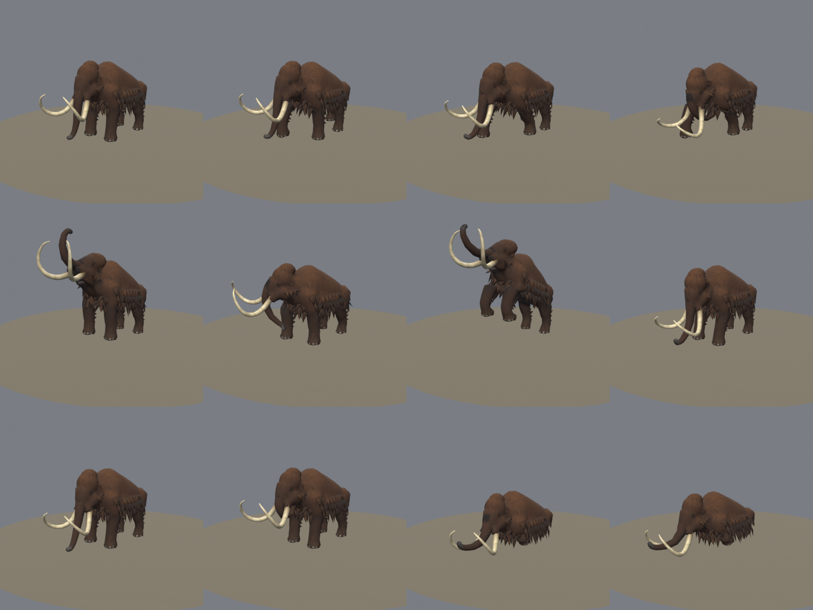

| Clip | Length | Notes |
|---|---|---|
| Sleep | 4.0 s loop | lying on its belly, legs folded, the trunk out along the ground, slow breathing |
| Wake | 2.0 s | heaves up front end first, shakes its head, ends in the Idle stance |
| Idle | 3.0 s loop | breathing, the trunk swaying and sniffing, ear flaps, tail swish, weight shifting |
| Walk / Run | 1.6 / 0.8 s loops | lateral walk 1.38 m/s; an elephant's amble (no suspension) 4.5 m/s (root motion) |
| Charge | 0.67 s loop | head down with the tusks levelled, trunk tucked under the chin, ears pinned, 6.3 m/s (root motion) |
| Trumpet | 2.0 s | stamps, rears its head with the trunk raised high, ears flared; event `Roar` at 0.6 s |
| TuskSwipe | 1.2 s | winds up to its left, sweeps the tusks across to the right with a step in, hooking up; event `Bite` at 0.5 s |
| Stomp | 1.6 s | rears its front end up, trunk high, and slams both forefeet down; event `Bite` at 1.03 s |
| Graze | 4.0 s loop | the trunk reaches to the ground, grips, curls the grass up to its mouth, it chews |
| Hit | 0.5 s | a flinch, the trunk whipping |
| Death | 2.5 s | staggers, kneels, sinks onto its belly and slumps right, the tusks propping the head; event `Dead` at 2.2 s |

Bones: the wolf's names with 2 tail bones, no tongue, Trunk1-6; sockets `Socket_Head`, `Socket_Mouth`,
`Socket_Back` (on the hump: a rider or a howdah), `Socket_Trunk` (the tip), `Socket_TuskL` / `Socket_TuskR` (the
tips). Unity: **Tools > Beasts > Rebuild Mammoth** (`Logs/MammothSetup`): `M_Mammoth`, `M_Mammoth_Dark`,
`Prefabs/Mammoth` (Animator, BeastAppearance rolling the two coats 2:1 and the size 0.92-1.06, BeastEvents),
`Animation/MammothAnims` (Sleep leads into Wake), and one mammoth in `Scenes/Beasts_Test`.

## Red deer stag

Cervus elaphus, a mature stag in autumn: prey for the hunting grounds (hide and venison), asked for on 2026-10-11.
1.20 m at the withers, 2.0 m nose to rump, 2.37 m to the antler tips; a deep chest, a slim waist, a rounded rump,
long thin legs on cloven hooves with dewclaws, a long thick neck with a full, shaggy rut mane under the throat, a long
head with a blunt, deep muzzle and a broad nose pad, big ears, large eyes (~1.5x), a short tail over a pale rump
patch, and antlers 0.93 m across (brow, bez and trez tines and a crown of three each side, the tines angled forward
and up). Blender scene **Deer** (`DER_*`), with an instance of the wolf beside it for scale.

| Part | Triangles |
|---|---|
| Fused body (trunk, neck, mane, head, shoulders and leg stumps, haunches, tail; incl. nose) | 2,522 |
| Lower legs (clean tubes grafted onto the stumps), hooves' claws and dewclaws | 864, 336 |
| Lower jaw, eyes, ears | 144, 120, 156 |
| **Body without antlers** | **4,142** |
| Antlers (lofted tubes, rigid on Head) | 1,248 |
| **DeerBody** | **5,390** |

One 1024² coat, `T_Deer`: grey-brown flanks with russet over the back, a grey-brown neck and a darker mane in long
locks, buff to cream belly, inner legs and rump patch (the tail's upper side dark), darker lower legs, a dark muzzle
and nose with a pale chin, a dark preorbital gland, brown grooved antlers with pale tips. The material is matte
(`deer_paint.matte`).

How it differs: **each leg is one surface in two parts**, a fused stump (upper arm to mid forearm, stifle to mid
gaskin) and a clean lofted lower leg stitched onto it (`deer_body._graft_legs`: fused and decimated, legs this thin
twist into diagonal facets), skinned down the leg by height; the **antlers** are lofted tubes (`PART['antler']`).
Bones: the wolf's names with **3 neck bones** (`Species(neck_n=3)`), 2 tail bones, no tongue; sockets `Socket_Head`,
`Socket_Mouth`, `Socket_Back`, `Socket_AntlerL` / `Socket_AntlerR` (the beams' tips). `deer_build.review_joins()`
renders the leg joins close up in the stress-test stride.

| Clip | Length | Notes |
|---|---|---|
| Idle | 4.0 s loop | breathing, a weight shift with a hind foot cocked, ear flicks, a tail flick, a slow look round |
| Graze | 5.0 s loop | head down at the grass (three neck bones), chewing, ears turning, a slow step forward (root motion 0.16 m a loop) |
| Alert | 1.5 s | head snaps up high, ears forward and stiff, tail up, a forefoot stamp; holds the end |
| Walk / Trot | 1.2 / 0.67 s loops | four-beat lateral walk 1.1 m/s, the head nodding; diagonal trot 2.9 m/s (root motion) |
| Run | 0.47 s loop | the flight gallop 8.1 m/s: long bounding strides, the back gathering and stretching, tail up over the rump patch, head forward (root motion) |
| Attack | 1.2 s | head down, a lunge forward and up with a twist of the antlers, the right forefoot stepping in; event `Bite` at 0.5 s |
| Hit | 0.5 s | a flinch sideways |
| Death | 2.2 s | the legs fold, it falls onto its left side, the head last with the antlers turned up; event `Dead` at 1.9 s; holds |
| Sleep / Wake | 4.0 s loop / 2.0 s | lying on its belly, legs folded under, the head low; rises hind end first |

Hooves slide at most 8 mm in Walk, Trot and Run (`deer_anim.slide_report`); the lowest vertex stays within 2.4 cm of
the ground in every clip (lying: the hooves).

## Dungeon ooze

An amoeba-like jelly that crawls through dungeons eating what it finds, adventurers included, asked for on
2026-10-12. It has a lumpy, see-through dome that spreads where it meets the floor, six blunt pseudopods, and a
wrinkled knot at the rear (the uroid, where a crawling amoeba's tail end bunches up). Inside it you can see a
dark-red nucleus (the weak spot), food vacuoles, and a half-digested adventurer: skull, two bones, a nasal helm,
coins, and a rusty sword that went in through its back and still sticks out. It is 3.0 x 2.9 m across with the pods
out and 1.2 m tall, hip-high on a person (`renders/ooze_scale.png` has a Humans body beside it). Blender scene
**Ooze** (`OOZ_*` cameras, floor and rim light).

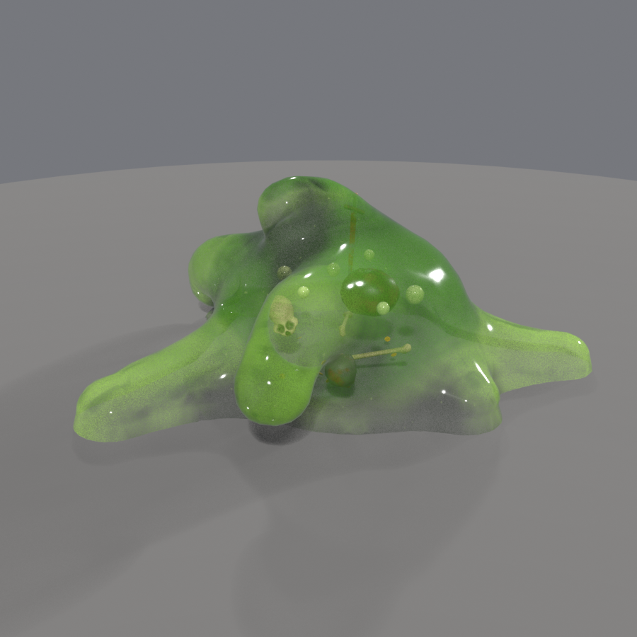

| Part | Triangles | Texture |
|---|---|---|
| `OozeBody`: the shell (dome, skirt, 6 pseudopods, uroid), open at the floor | 2,844 | `T_Ooze` 1024², linear masks: R tone (thin, mid, core), G shade, B detail, A opacity; the colour is the shader's |
| `OozeContents`: nucleus (and its hidden twin), 7 vacuoles, skull, femur, shin, helm, 7 coins, sword | 2,070 | `T_OozeContents` 512²: RGB colour, A smoothness |

How it differs from the furred beasts:

- **The shell is one distance field** (`ooze_body.field`), meshed with openvdb like the Humans skeleton's skull and
  decimated uniformly. Its parts: three ellipsoids for the mass plus a skirt; round cones along splines for the pods
  (`POD`, each 4 control points `(x, y, z, r)`, a swollen tip); balls for the uroid; low-frequency noise.
  - Below 10 cm the wall is carried straight down and leans out to the floor, so there is no undercut and no paper
    edge.
  - The sole is cut away, together with every down-facing sliver near the floor.
- **The contents sit at least 7 cm inside the field** (`ooze_contents`), except the sword.
- **UVs**: 14 charts (each pod, a top cap, four sides), plus a slit along each raised pod's underside. Texel density
  stays within 0.4–1.5x of the median.
- **Paint without Cycles**: `ooze_paint.texel_bake` rasterises the UVs in numpy. The shell's colour and opacity come
  from the field:
  - thickness: the thick core is darker and more opaque, the tips and the skirt's edge clearer;
  - AO;
  - streaks along the pods (cytoplasm streaming).

  These are written as masks, not colours. A colour preset (`ooze_paint.PRESETS`, the same as Unity's
  `OozeLook.Presets`: Green, Grey, Black, Ochre, Crimson) maps them through thin, mid, core and crevice colours.
- **Materials** (the Blender preview of the Unity look):
  - `M_Ooze`: the masks coloured by a preset (`shell_material(preset=...)`), dithered alpha. Opacity is the texture
    times the preset's opacity, plus a fresnel rim. It has a faint emission, is two-sided,
    smoothness 0.9, and casts a transparent shadow.
  - `M_OozeContents`: opaque.

**Rig** (`ooze_rig`, 47 bones):
- Root, Motion;
- Body, then:
  - HalfL / HalfR, the mass's halves, which part in Split. Each carries its own dome (DomeL / DomeR: leaves for
    squash, stretch and lean, which move as one Dome in every other clip) and its side's pods;
  - WaistTop / WaistLow, the middle band, which pinches to a strand in Split;
  - Tail (the uroid);
- `<Pod>1–3` for Reach, Back and Bud (left) and Lead, Side and Probe (right);
- Gut, with one bone per floating piece: Nucleus and Nucleus2 (its twin hidden inside, which divides out in Split),
  Skull, Femur, Shin, Helm, Sword, Coins, Vac1–7;
- sockets: `Socket_Gut` (a swallowed victim), `Socket_Mouth` (a grabbed one, carried in by Engulf) and `Socket_Spit`
  (the Probe's tip).

How the shell is weighted:
- by a soft minimum over the shape's pieces (`ooze_body.parts`);
- along each pod, by hat weights on the chain, so a stretched pod stretches along its whole length;
- in the mass, upper or lower by height, split left/right across the middle;
- smoothed;
- after smoothing, the middle band is re-split onto the waist (`_waist_pass`), and a vertex that is mostly pod takes
  its pod's side;
- below 16 cm handed to the lower mass, so the rim stays on the floor.

Pods are posed by bending, by stretching (child bones slide along the chain) or by laying the chain along a curve to a
target (`OozePose.curve`). Whatever sits in the domed part of the mass follows the Dome by the skin's own weight.

| Clip | Length | Notes |
|---|---|---|
| Idle | 3.0 s loop | the dome breathes, a wave runs down each pod, the uroid wags, the contents drift, the nucleus pulses |
| Crawl | 2.0 s loop | amoeboid flow at 0.6 m/s (root motion 1.2 m a loop): the leading pods reach out, the mass surges into them, the rear pods and the uroid trail, the contents slosh |
| Lash | 1.33 s | the Probe rears back and slams down in front; event `Hit` at 0.67 s |
| Grab | 1.47 s | Reach shoots out 0.5 m, swells round what it caught and hauls it back; event `Hit` at 0.6 s |
| Engulf | 2.67 s | Reach and Lead close round a victim in front, the dome rolls over it and the Probe comes down on top; `Socket_Mouth` carries the victim in to `Socket_Gut`; events `Grab` at 0.73 s, `Engulf` at 1.53 s |
| Spit | 1.47 s | the Probe aims forward and up, the dome contracts and pumps; event `Spit` at 0.7 s (from `Socket_Spit`) |
| Hit | 0.8 s | a jolt: a damped wobble, the pods flinch |
| Death | 2.33 s | collapses into a puddle with a last shudder: raised pods flop, the vacuoles pop one by one, the remains sink to the floor; event `Dead` at 1.87 s; holds |
| Puddle / Rise | 3.0 s loop / 1.67 s | lying flat and alive (an ambush), rippling; rises from it with an overshoot; event `Risen` at 1.0 s |
| Split | 2.5 s | binary fission, for a big ooze: the pods draw in, the nucleus divides, the halves part with a waist pinching between them; event `Split` at 1.93 s (the strand snaps: the game swaps in two oozes, behind a splash) |
| Reform | 1.67 s | such a new ooze taking shape: from a blob (Split's end pose, half of it) the pods push out with an overshoot |

The Hit clip also has an event, `Hurt` at 0.07 s, for a splash.

`ooze_anim.report()` checks every clip. Last run:
- the rim stays within 4 cm of the floor;
- the shell goes at most 4.4 cm under the floor (the Lead pod in Engulf);
- no content vertex leaves the shell (a majority vote of three upward rays);
- the remains lie on the floor in Death and Puddle (`_sink_z` reads their lowest points from the mesh: a centroid
  target sank the rotated helm through the floor).

**In Unity** (2026-10-12):
- **Rebuild:** Tools > Beasts > Rebuild Ooze (`OozeSetup.cs`). It writes a report, renders and a root-motion trace
  to `Logs/OozeSetup`. It needs `Shaders/OozeJelly.shader` + `OozeJellyForward.hlsl`, which the install script now
  copies.
- **The jelly shader (`Beasts/OozeJelly`):**
  - two passes over the shell, the far side (back faces) first, then the near side;
  - the colour comes from four material colours (thin, mid, core, crevice) mapping T_Ooze's masks. `OozeLook` sets
    them per renderer with a MaterialPropertyBlock, so one material serves every colour;
  - premultiplied alpha: the diffuse fades with the opacity, the highlights don't;
  - opacity = the texture's alpha x `_Opacity` + a fresnel rim, a faint glow of its own colour, a small vertex wobble;
  - a shadow dithered by the opacity;
  - Forward+ lighting through `UniversalFragmentPBR`, so torches light it.
- **The contents** use URP Lit (`M_OozeContents`).
- **`OozeLook`:**
  - a colour preset (fixed, or random from a list), a size, which remains are hidden;
  - in an ooze bigger than 1x the remains keep their real size (done after the Animator, idempotently).
- **`OozeFx`** (built in code):
  - a slime trail while it moves (`OozeTrail`, shader `Beasts/OozeSlick`): splats that know about each other. The ooze
    paints soft, ragged splats at its rear edge into a small wetness field (128² R8, 0.1 m a texel x size, tied to the
    world and wrapping); one flat sheet round it shows slime where the field passes an edge threshold, its slope
    tilting the normal for a wet highlight. Splats merge into one sheet with smooth necks (no alpha piling up where
    they overlap). A new splat wells out from its middle over a second (`grow`: the drying in reverse), so none is
    stamped in whole, and as the field dries over 9 s the edges creep in and it breaks into puddles. No splat lands
    under the see-through body. (It replaced a TrailRenderer that folded on turns and showed its fresh end through the
    jelly, then a fold-free ribbon whose end still showed.)

    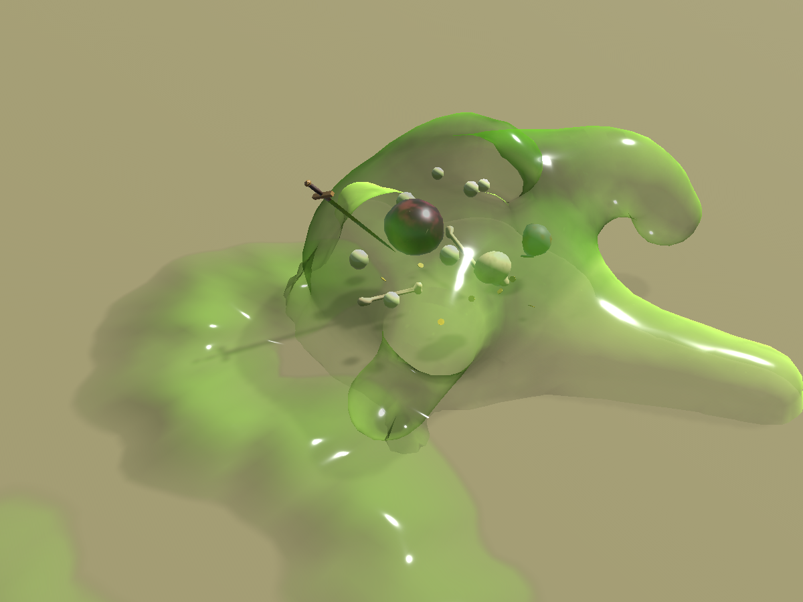

  - drips from under the raised pods' tips;
  - splashes on Hit, Hurt, Grab, Engulf, Dead, Split and Risen;
  - on Spit, an `OozeGlob` arcs from `Socket_Spit` to a target, splashes, and leaves a fizzing acid puddle.

  The trail and splashes live on an object beside the ooze, so they outlast it.
- **`OozeSplit`:** on the Split event it spawns two `childPrefab`s at the HalfL / HalfR bones, at 0.79x the size,
  in the same colour. Each keeps only the remains on its own side (worked out from the model by `OozeSetup`) and
  starts on Reform. `SplitInto` hands the two to the game. With `respawnAfter` (the test scene: 25 s) the big one
  only goes dormant and comes back rising from a puddle.
- **Prefabs**, each with an Animator, `OozeLook`, `BeastEvents` and `OozeFx`; renderer bounds padded 0.8 m for the
  reaching pods:
  - `Ooze`: random colour, 0.9–1.1x;
  - `GiantOoze`: 1.6x, green or black pudding, with `OozeSplit`;
  - `SmallOoze`: 0.5–0.6x, with no skull, helm or sword inside.
- **The clip pools** (`OozeAnims`, plus `GiantOozeAnims` with Split): Puddle leads into Rise, and so does Death.
  `Beasts_Test` has two oozes, three small ones and a giant.
- **Effect assets**, drawn by `OozeSetup`: `Textures/FX/` (drop, splat, flat mask), `M_OozeTrail` (Beasts/OozeSlick),
  `M_OozeDrop`, `M_OozePuddle` (URP Particles/Lit, with "preserve specular" off: on, every quad showed whole),
  `M_OozeGlob` and `Models/OozeGlob.asset`.
- **Checked:** avatar valid; Crawl 0.60 m/s, `dir=(0, 0, 1)`; 1.200 m per loop over 3 loops, with the Body's offset
  unchanged at every loop start.
- **The test scene and the renders no longer change the scenes open in the editor:** `BeastsTestScene.Build` fills
  the scene additively, and the ooze's renders use a preview scene.

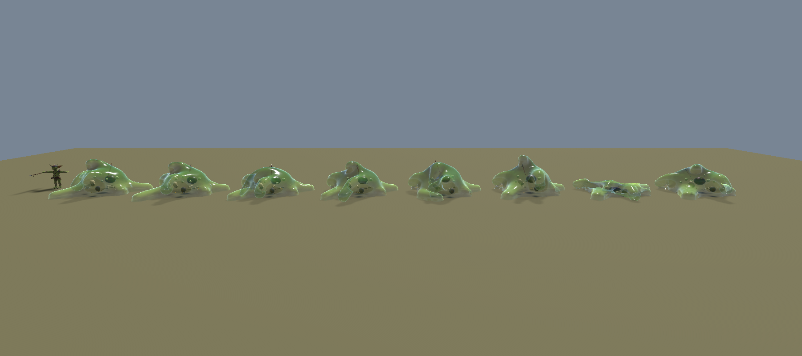

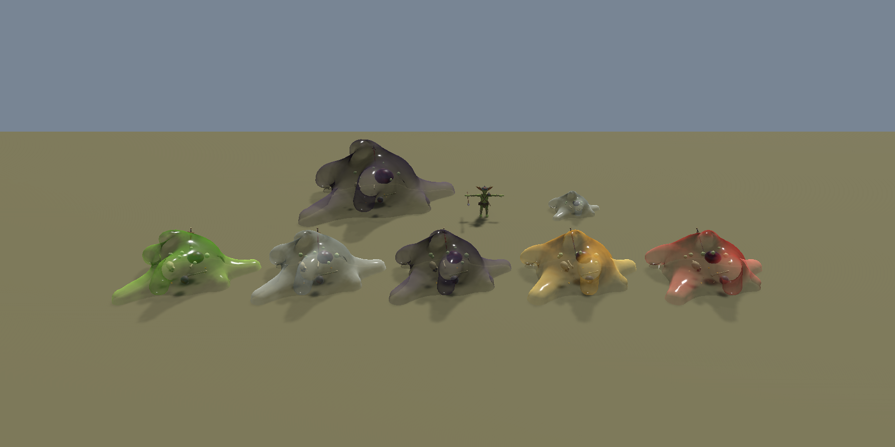
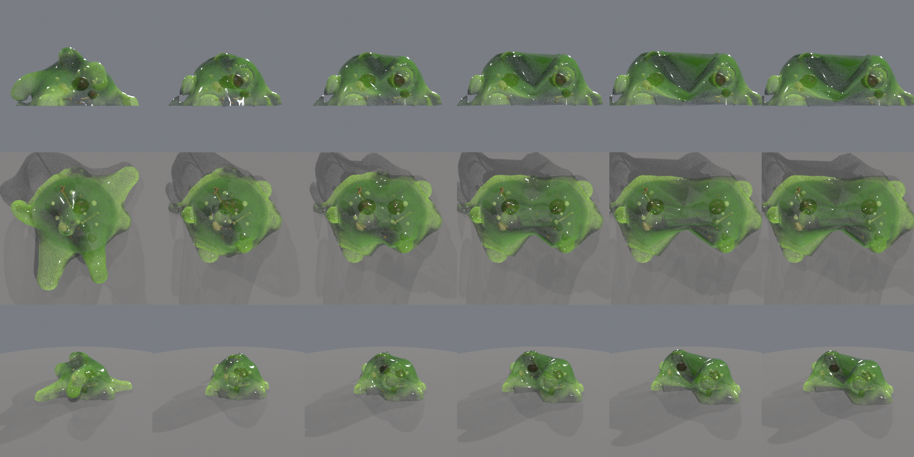
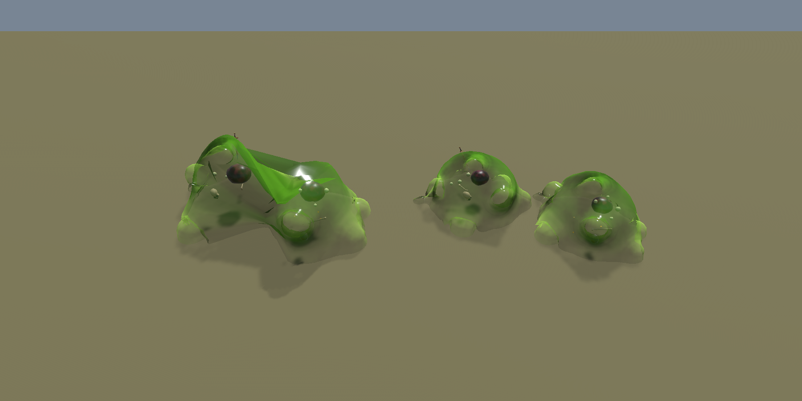
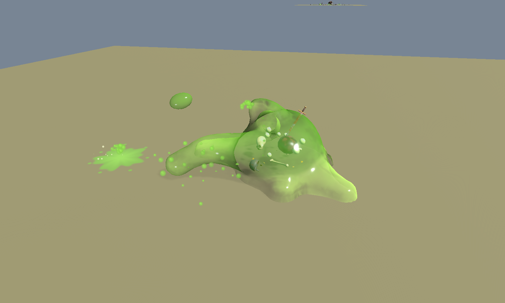

## Warg

The goblin raiders' mount (2026-10-12), from Daniel's reference: a massive, shaggy, dark brown-grey wolf with yellow
eyes and bared fangs; the goblins' ones wear a saddle, a bridle and a bone war-mask. About 1.35x the wolf (withers
1.1 m, nose to rump 2.1 m). Blender scene **Warg** (`WRG_*` cameras, a wolf beside it for scale).

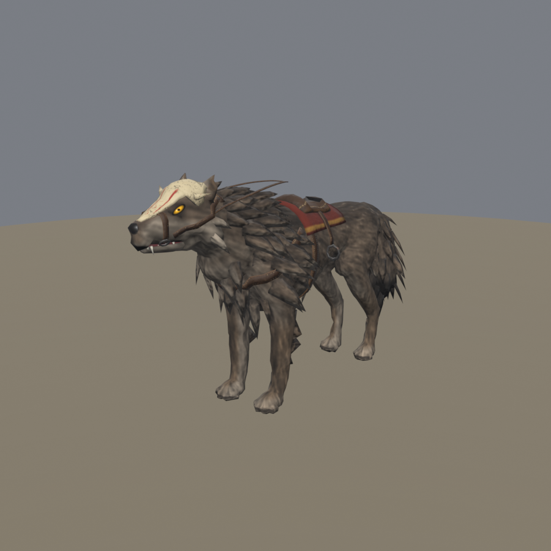

| Part | Triangles | Texture |
|---|---|---|
| `WargBody`: fused fur body 4.3k, jaw, tongue, teeth and eyes 0.9k, hair shells 1.9k | 7,072 | `T_Warg` (dark), `T_Warg_Ash`, `T_Warg_Black` 1024², A = smoothness; `T_Warg_Normal` for all three |
| `WargTack`: blanket, seat, girth, breast collar, stirrups, bridle, bit rings, reins | 1,564 | `T_WargTack` 512² + `T_WargTack_Normal` |
| `WargMask`: the bone war-mask, two horns | 304 | (the tack's) |

How it is built:

- **The wolf's recipe, made bigger** (`warg_body`): the wolf's landmarks edited for a deeper chest, broader skull,
  thicker legs and big paws, then mapped to the world by `hw()`, which enlarges the head, shortens and deepens the
  muzzle (`_mz`) and scales everything by `S = 1.35`. The masks, the painter and the rig read wolf units through
  `hw_inv`, so they read like the wolf's.
- **The shag is separate hair** (`beast_coat.clump`): staggered tiers of spiky locks round the neck (`TIERS`: the
  mane from the poll to the shoulders, each tier lying back over the next and stopping before the saddle), a bib
  under the throat, a belly fringe, rings of locks making the tail a brush (`TAIL_RINGS`), fringes down the backs of
  the forearms and single locks (cheeks, elbows, breeches). Each is rooted by a ray cast onto the fur and skinned like
  the skin at its root. (Fused tufts melted into lumps at this size.)
- **Eyes:** slanted almonds low at the stop under a heavy brow, laid onto a smooth fit of the socket.
- **Paint** (`warg_paint`, the wolf's painter): long painted locks with dark partings on the coat, and on each hair
  lock (its texels know its root: `bake_data(roots=True)`) strands down its length, a dark root and grizzled tips.
  The same relief makes the normal map (`beast_paint.write_normal_map`, image-space gradients within each island).
- **Tack** (`warg_tack`), for the ridden ones only: fitted onto the built body by ray casts (straps lie on the fur,
  the blanket drapes over the back, the mask is notched clear of the eyes). Weights are copied from the skin under
  each piece; the bridle and the mask ride on Head, the reins blend Head → Neck1 → Spine2. The info attribute holds
  the part and (along, across) for the painter: stitching inside the straps' edges, the blanket's ochre border, the
  mask's cracks and red war paint.

Clips (`warg_anim`): the wolf's twelve, every distance ×1.35, the gaits a little slower.

| Clip | Length | Notes |
|---|---|---|
| Idle / IdlePant | 4.0 s / 3.0 s loop | |
| Walk / Trot / Run | 0.93 / 0.6 / 0.47 s loop | root motion 1.16 / 2.48 / 6.36 m/s |
| Bite | 1.2 s | event `Bite` at 0.5 s |
| Lunge | 1.6 s | leaps 2.2 m, event `Bite` at 0.93 s |
| Threat, Howl, Hit | 2.4, 3.5, 0.5 s | `Howl` at 0.8 s |
| Death / GetUp | 2.2 / 1.5 s | onto its left side, `Dead` at 1.9 s |

**In Unity:** Tools > Beasts > Rebuild Warg (`WargSetup.cs`). `Prefabs/Warg` is wild (tack and mask off);
`Prefabs/WargRidden` is saddled and masked. The `WargTack` component switches the two meshes (`saddled`, `masked`)
and finds `Socket_Saddle` (`Seat`) for a rider. `BeastAppearance.target` puts the coat on `WargBody` only.

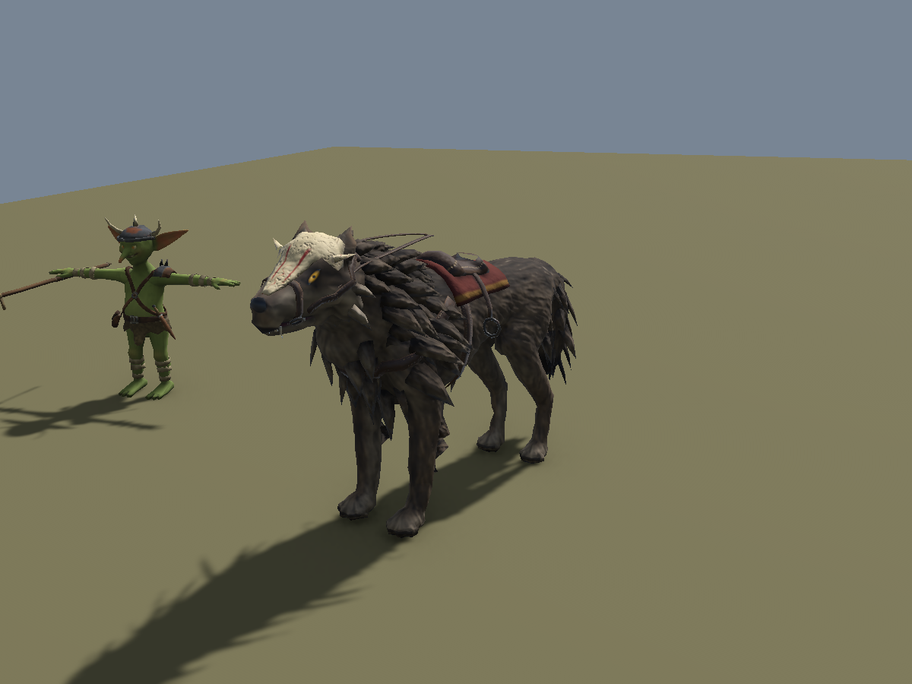

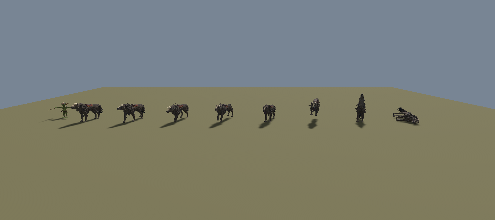

Rebuild in Blender (Warg scene on screen):

```python
import warg_build
warg_build.show()
body, rig, report = warg_build.build_model()      # body, rig, weights, UVs, coats
import warg_tack; warg_tack.build(body, rig)      # the tack and the mask (work layer on: warg_build.work_layer(True))
warg_build.export()                               # clips + Warg.fbx + textures into export/
```

## Zombie wolf

A unit from Daniel's card game, in the undead batch (the zombies, skeletons and the ghoul are in the Humans repo).
Daniel: "don't bother with adding them to the game, build the creatures" - so model, paint and export; no game side.
The grey wolf dead and risen: starved, mangy, torn open. Its own file, `blender/zombie_wolf.blend` (scene
**ZombieWolf**, cameras `ZWF_CAM_*`), built headless.

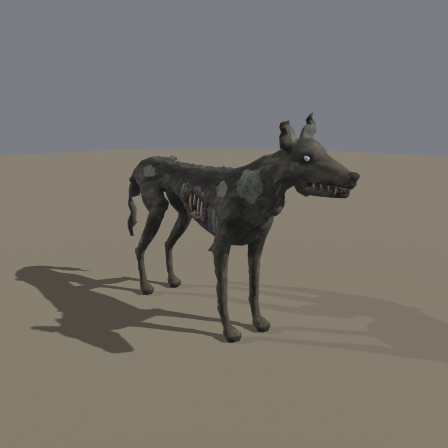

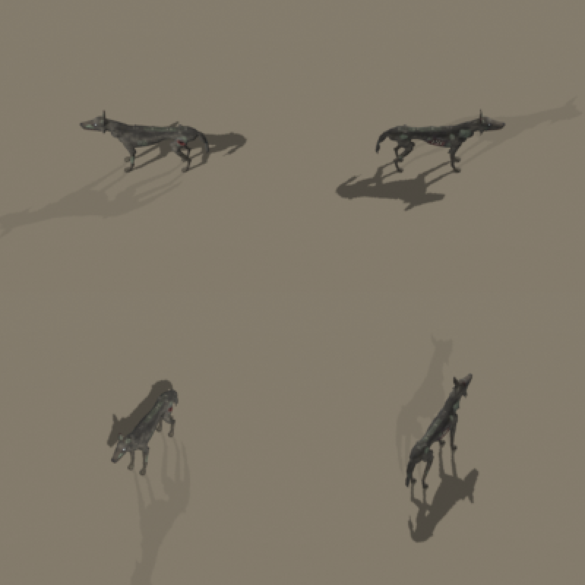

| Part | Triangles | Texture |
|---|---|---|
| Fur body (starved, the cavity, spine processes, hip points) | 3,891 | `T_ZombieWolf` (grey), `T_ZombieWolf_Dark`, `T_ZombieWolf_Pale` 1024², A = smoothness, no normal map (the wolf has none) |
| Lower jaw, tongue, nose | 392, 108, 9 | |
| Teeth (bared), eyes (milky) | 256, 120 | |
| Rib bars across the hole | 300 | |
| **ZombieWolfBody** | **5,076** | |

**The wolf's skeleton, exactly.** `zwolf_body` keeps `wolf_body`'s landmarks, head warp and `rest_bones()`; the rig is
named `WolfRig` like the wolf's. So every wolf clip plays on it unchanged, in Blender and in Unity (the clips' curve
paths are the same: the export's bind pose matches Wolf.fbx bone for bone). `zwolf_anim` keys `wolf_anim.CLIPS` onto it
and they are exported as `ZombieWolf@<clip>.fbx`, so its Unity setup stands alone.

How it is built:

- **Starved:** the wolf's lofts with a narrow ribcage, the belly drawn up behind the last ribs, wasted thighs,
  shoulders and neck, thin upper legs with knobby wrists and stifles, a thin tail. Fused ellipsoids under the skin:
  the spine's processes (withers to croup), hip points, pin bones and the shoulder blades' ridges.
- **Mangy:** nine of the wolf's tufts, longer and thinner; bald patches (`BALD`, one mask shared by the fur sculpt and
  the painter, domain-warped and frayed) get no fur and sink 2.5 mm. The spine's strip is broken, the tail's end bare in
  patches, the leg patches on the outside only.
- **The torn right flank** (`WOUND`): a cavity sculpted 3.4 cm deep with a ragged outline and a raised torn rim, high
  on the flank (the game camera looks down at 50°), with five rib bars across it as separate lofts (each its own width
  and depth, one snapped), laid on the flank's surface from before the cavity and weighted from the skin under them.
  The painter knows how deep each vertex really sits (`info.b`). A shallow torn patch over the left haunch (`GASH`).
- **Face:** the right ear torn (its tip gone, a V out of its outer edge: a clamp in the ear's own frame, after the
  symmetrize), the upper lip drawn back off the teeth (the muzzle's lip line raised, the upper teeth rooted in the gum
  and hanging outside the lower jaw), deep sockets, gaunt cheeks and temples, eyes 1.12x the wolf's.
- **Paint** (`zwolf_paint`, the wolf's layout dulled and dirty): grey-green rotting skin with bruises, green rot and
  veins, the fur thinning into it in strands; ribs drawn on both flanks, hip bones picked out pale; the spine a broken
  line of knobs (2026-10-23: the bald strip had read as a racing stripe at the game camera): its skin dark grey-green
  near the coat's own back colour, matted fur across it in stretches, most processes stained dark and only six
  (`PALE_KNOBS`) bone-pale; the cavity near-black with wet red walls, a pale torn edge, dried blood round it and drips below; milky eyes in
  dark sockets, dark gums, yellow teeth, blood round the mouth and down the throat, the torn ear's edge crusted. The
  rot is the Humans zombies' (`#7f8b72`, `#8e9680`, bone `#d8cfb4`). Coats: grey (default), dark (a black wolf's),
  pale (a white wolf's, yellowed).

Clips: the wolf's twelve (see [Clips](#clips-30-fps)). Death lies on its left side, so the torn flank faces up. Lowest
vertex: standing clips 0.0, Lunge -0.008, Death and GetUp -0.025.

Rebuild (headless; two to three minutes for everything):

```
blender.exe -b --factory-startup --python tools/zwolf_run.py -- build review game clips lowest testpose closeups sheets coats export
blender.exe -b --factory-startup blender/zombie_wolf.blend --python tools/zwolf_run.py -- paint review game
```

`paint` repaints the built model (same UVs) for paint-only changes. Renders: `renders/zwolf_<view>.png` (34, 34r, side,
sider, top, face, facer, headside(r), headfront, rear, wound, above, colony), `zwolf_game_sheet.png` (the game camera:
22 m, 50°, fov 30, the wolf ~90 px, blown up x3), `zwolf_frames_<Clip>.png` (EEVEE frames round the wound and the face),
`zwolf_clip_<Clip>.png`, `zwolf_coats.png`, `uv_layout_zwolf.png`, `zwolf_vs_wolf_game.png` (the grey wolf above, the
zombie below, at the game camera) and `zwolf_spine_game_before_after.png` (the spine before and after 2026-10-23).

**In Unity:** copy the new files (assets first, then the script) and run Tools > Beasts > Rebuild Zombie Wolf
(`ZombieWolfSetup.cs`; it also runs by itself on the first import). It makes `M_ZombieWolf` (+ `_Dark`, `_Pale`),
`Prefabs/ZombieWolf` (Animator, `BeastAppearance` with the three coats, `BeastEvents`), `Animation/ZombieWolfAnims`
(the wolf's pools) and lineup renders in `Logs/ZombieWolfSetup` (a preview scene). It touches no scene.

```
$B = "E:\Unity\Projects\GameArtGeneration\Beasts"; $U = "E:\Unity\Projects\MedievalSetting\Assets\Beasts"
Copy-Item "$B\export\ZombieWolf.fbx" "$U\Models\"
Copy-Item "$B\export\Anims\ZombieWolf@*.fbx" "$U\Models\Anims\"
Copy-Item "$B\export\Anims\zombiewolf_clips.json" "$U\Models\Anims\"
Copy-Item "$B\textures\T_ZombieWolf*.png" "$U\Textures\"
Copy-Item "$B\unity\Beasts\Editor\ZombieWolfSetup.cs" "$U\Scripts\Editor\"
```

## Giant bat

A unit from Daniel's card game (2026-10-23; "Keep moving on the creatures", "don't bother with adding them to the
game, build the creatures"): model, paint, clips and export, no game side. My calls: a wolf-sized body (0.80 m nose to
rump), 2.9 m across the wings, big upright ears, a short pug snout with an upturned nose pad and a nose leaf, two long
upper fangs outside the lower jaw, red eyes, dark brown-black fur with a rusty mantle, dark leather wings that thin
and redden toward the trailing edge; no tail and no tail membrane. Its own file, `blender/bat.blend` (scene **Bat**,
cameras `BAT_CAM_*`), built headless.

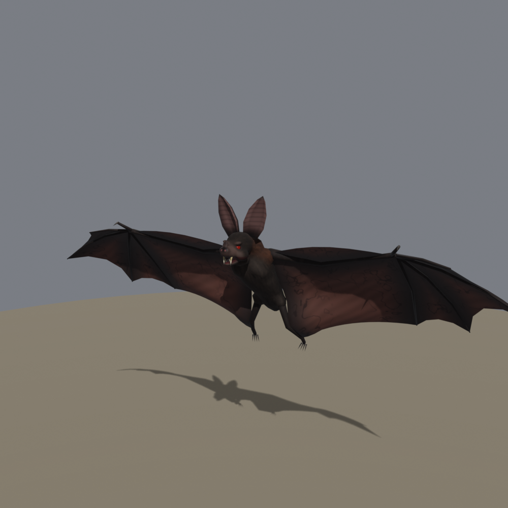

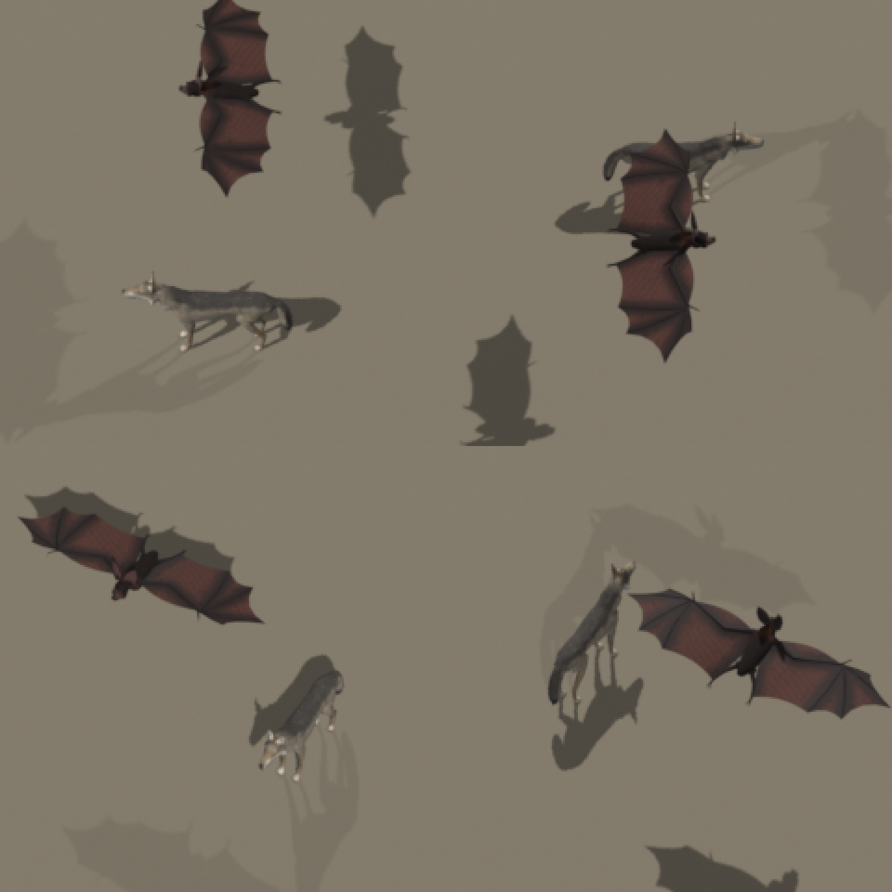

| Part | Triangles | Texture |
|---|---|---|
| Fused fur body (trunk, mantle, shoulders, pectorals, thigh stumps, head, muzzle, nose pad and leaf, brows) | 1,896 | `T_Bat` 1024², A = smoothness, one texture for both meshes |
| Arms, fingers, thumbs, hind legs (clean lofts); claws | 632; 88 | |
| Ears, eyes, fangs, lower jaw | 156, 100, 68, 220 | |
| **BatBody** | **3,160** | `M_Bat` |
| **BatWing**: the membranes (Coons patches), 960, and their underside (the same faces copied and flipped), 960 | **1,920** | `M_BatWing`: the same texture, back faces culled |
| **Bat** | **5,080** | |

How it is built:

- **Always in the air.** The bind pose is the flying pose with the body's centre 1.6 m over the Root (`bat_body.H`).
  The game moves it on the ground like the other beasts; only Death brings it down.
- **The dragon's wings, parametrised** (`dragon_body.WingSpec`; the dragon's own is `DRAGON_WING`, and its bones,
  membranes and helper poses come out bit-identical): four fingers (digit 2 along the leading edge, 3 to the tip, 4
  and 5), the thumb with its claw, the arm panel's flank edge running down the body to the knee and the ankle
  (`WS.flank`, weighted on Chest, Spine1, Thigh, Shin) and its 12 helper bones (`WingMem*`), finer scallops.
- **Pieces in a `dragon_body.Acc`**, so every vertex carries its own weights: chain weights along the arm, finger and
  leg lofts, the membranes' Coons weights, ears, eyes, fangs and jaw rigid. The fused fur gets heat weights solved on
  a copy of the fur alone (`bat_body.heat_weights`), so the membrane sheets stay out of the heat solve.
- **The wings are split off after painting** (`BatWing`); both meshes share the UVs and `T_Bat`. The membranes face up
  in the bind pose (`_membranes_up`).
- **The membrane has an underside of its own** (2026-10-23): `bat_build._two_layers` copies every wing face onto new
  vertices (same UVs, weights, info), flips the copies and tags them (`back` face attribute); `M_BatWing` culls back
  faces, in Blender and in Unity. A material drawn from both sides (URP Lit `_Cull` 0) lit the underside with the upper
  side's normals, so it read as bright as the top from below; now each side is lit with its own normal in any shader
  or render path. `paint` bakes the single sheet (`_one_layer`) and puts the underside back.
  `renders/bat_underside_before_after.png`: from below and from a low 3/4, left the old look (back faces shaded with
  the front normal, as Unity did), right the two layers.
- **Paint** (`bat_paint`): fur strokes along the flow, a grizzled crown, the bare face, the ears' cross ridges, the
  wings darker along the bones with veins branching off them and creases along the fingers.

Bones: Root, Motion, Hips, Spine1, Chest, Neck1, Head, Jaw, EarL/R, Thigh/Shin/HindFoot/HindToes, the dragon's wing
chain (WingScap, WingArm, WingForearm, WingHand, WingThumb, WingF1_1..F4_2) and `WingMem<i><j>` per side; sockets
`Socket_Head`, `Socket_Mouth`. 74 bones.

| Clip | Length | Notes |
|---|---|---|
| Idle | 1.6 s loop | a lazy hover: two slow beats, the body raised, legs hanging, looking round, an ear flick |
| Hover | 1.07 s loop | the tense hover facing a target: two quicker beats, upright, jaw ajar, claws forward |
| Fly | 0.67 s loop | one wingbeat, down and forward, up with the hand drawn in; root motion 4.5 m/s |
| Dive | 1.5 s | rears, half folds and swoops 1 m forward and 0.8 m down to bite, the hind claws reaching, and beats back up (in place); event `Bite` at 0.73 s |
| Screech | 1.8 s | rears with the wings spread, head out, jaw wide, ears back; event `Screech` at 0.5 s |
| Hit | 0.5 s | knocked back and up, the wings flinch |
| Death | 2.0 s | the wings jerk and fold, it drops and lies on its belly, the wings flat, the head turned; event `Dead` at 1.3 s; holds |

Wing strokes are the dragon's: the spread wing turned about the shoulder (`Y` down/up, `Z` sweep, `X` pitch), blended
bone by bone toward the folded wing (`bat_anim.FOLD`) and curled. A stroke that would put a joint or finger tip under
the ground is lifted (`Pose.floor`, bisected). Lowest vertex: the flying clips stay above 0.6 m, the Dive's wingtips
0.19 m, Death -0.012 at the landing. Fly traced over 3 loops: 3.0 m a loop, Motion's turn 0, the head's step at the
seam as inside the loop.

Rebuild (headless, about a minute):

```
blender.exe -b --factory-startup --python tools/creature_run.py -- bat build review game clips lowest trace sheets closeups hero export
blender.exe -b --factory-startup blender/bat.blend --python tools/creature_run.py -- bat paint review
```

Renders: `renders/bat_<view>.png` (front, side, top, below, 34, 34r, rear, face, facer, headside, headfront, wing),
`bat_game_sheet.png`, `bat_vs_wolf_game.png` and `bat_vs_wolf_34.png` (the wolf from `blender/beasts.blend`),
`bat_clip_<Clip>.png`, `bat_frames_<Clip>.png`, `bat_hero*.png`, `uv_layout_bat.png`.

**In Unity:** copy the files (assets first, then the script) and run Tools > Beasts > Rebuild Bat (`BatSetup.cs`; it
also runs by itself on the first import). It makes `M_Bat`, `M_BatWing` (back faces culled, `_Cull` 2), `Prefabs/Bat` (Animator,
`BeastAppearance` for the size, `BeastEvents`; the renderers' bounds padded for the wings), `Animation/BatAnims`
(Idle and Hover, Fly, Screech leading into Dive, Hit, Death) and lineup renders in `Logs/BatSetup` (a preview scene).
It touches no scene.

```
$B = "E:\Unity\Projects\GameArtGeneration\Beasts"; $U = "E:\Unity\Projects\MedievalSetting\Assets\Beasts"
Copy-Item "$B\export\Bat.fbx" "$U\Models\"
Copy-Item "$B\export\Anims\Bat@*.fbx" "$U\Models\Anims\"
Copy-Item "$B\export\Anims\bat_clips.json" "$U\Models\Anims\"
Copy-Item "$B\textures\T_Bat.png" "$U\Textures\"
Copy-Item "$B\unity\Beasts\Editor\BatSetup.cs" "$U\Scripts\Editor\"
```

## Giant turtle

The second card-game unit of the round (2026-10-23; no game side). My calls: a huge, slow land and swamp turtle
after the alligator snapping turtle: a 2.6 m carapace standing 1.6 m high, domed, with three keels of pointed knobs
and a saw-toothed back rim, moss over the top and lichen and barnacle crusts toward the rim; a small plastron joined
by bridges; a big wedge-shaped head with a hooked beak, amber eyes with a dark star, a pink mouth with the snapper's
worm-like lure on its tongue; a thick wrinkled neck; columnar, elephantine legs on round feet with blunt claws; a
short crested tail. 3.5 m from beak to tail tip. Its own file, `blender/turtle.blend` (scene **Turtle**, cameras
`TRT_CAM_*`), built headless.

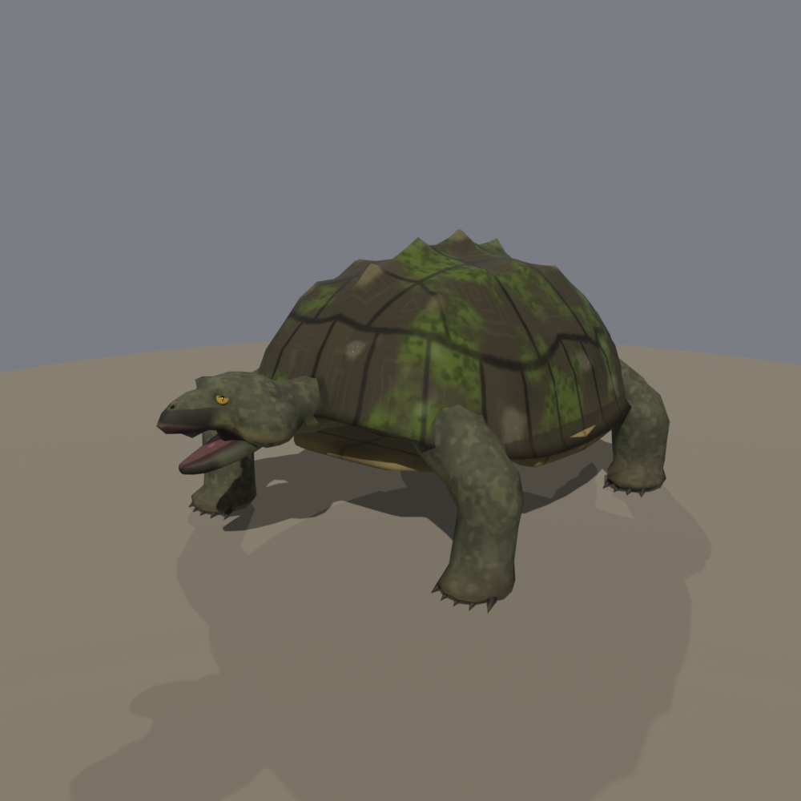

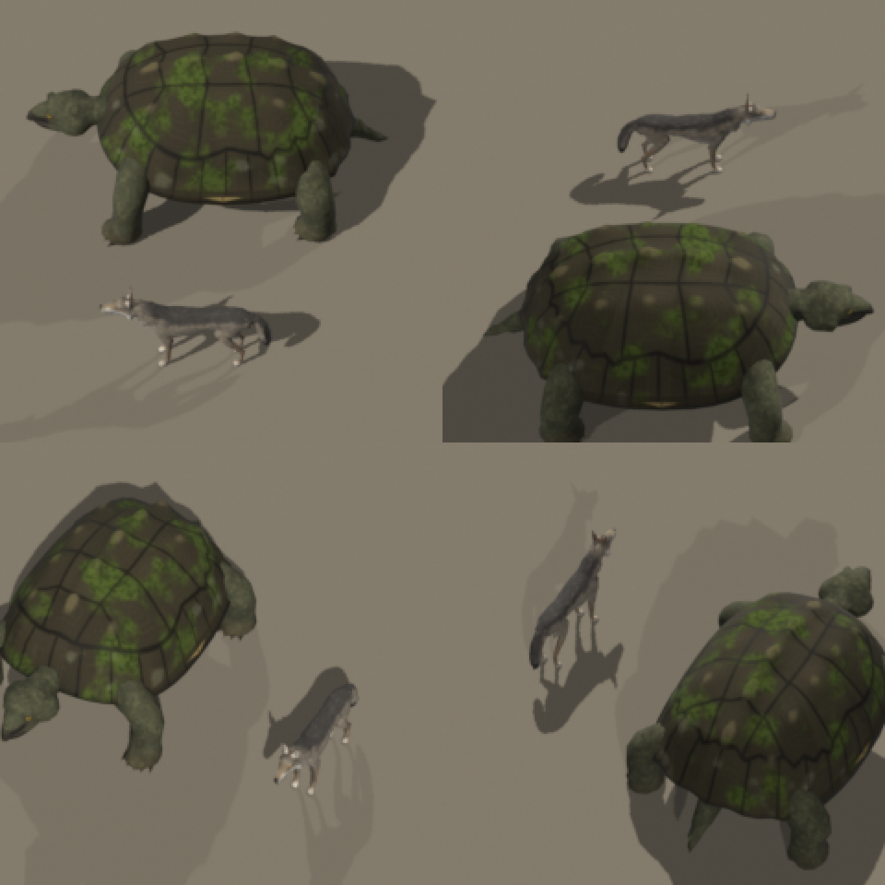

| Part | Triangles | Texture |
|---|---|---|
| Fused skin (a core under the shell, neck, head, legs and feet, tail) | 2,796 | `T_Turtle` 1024², A = smoothness |
| Carapace (outer dome, rolled lip, inner dome), plastron, bridges | 2,208 | |
| Lower beak, eyes, claws | 312, 120, 396 | |
| **TurtleBody** | **5,832** | `M_Turtle` |

How it is built:

- **The carapace is one parametric closed shell** (`turtle_body.build_carapace`): a superellipse outline, rim heights
  lower at the sides than at the front and back (the leg and neck openings), a domed profile plus the keels' knobs
  (`_relief`), the marginal scutes rolled out and under into a lip, and an inner dome back up. It rides rigid on
  Spine1; the spine never bends.
- **The skin is fused** (`beast_body.fuse_body`, 12 mm voxels) and heat-weighted on its own
  (`beast_rig.skin_with_pieces`, shared with the bat); the lower beak is a separate loft on `Jaw`, and the skin under
  the head follows it (`jaw_weight`, bounded on every side).
- **UVs:** the carapace unwraps as one disc (its builder cuts round the rim); the hidden inner dome and the plastron
  are packed small (`beast_paint.unwrap(island_scale=...)`, from tags in `info.b`). **Paint:** the scutes laid out
  like a turtle's (vertebrals with chevron borders, costals fanning out, marginals), grooves and growth rings, worn
  knobs, moss, lichen and barnacles, mud low down; mottled scaly skin, a pale throat, the horn beaks.

| Clip | Length | Notes |
|---|---|---|
| Idle | 4.0 s loop | slow breathing, looks one way and the other, gapes for a while (the lure) and shuts |
| Walk | 1.6 s loop | a slow lateral walk, the shell rocking; root motion 0.34 m/s |
| Bite | 1.1 s | draws the head back, jaw wide, then the neck shoots 0.36 m out and the beak snaps shut; event `Bite` at 0.53 s |
| Withdraw | 1.2 s | the head and neck slide into the shell, the legs fold in, the shell drops onto its plastron; holds |
| Emerge | 1.4 s | out again and a look round |
| Hit | 0.5 s | a jolt, the head half pulled in |
| Death | 2.5 s | the legs give way, the shell drops and tips a little, the head slides out onto the ground, jaw slack; event `Dead` at 2.0 s; holds |

`p.retract` (`turtle_anim`) slides the neck, head and jaw along the trunk (back into the shell, or out for the snap)
in the Species' extra hook. Lowest vertex: standing clips within 1.6 cm, Withdraw/Emerge 3.1 cm (a foot pad mid-way),
Death 1.9 cm. Walk traced over 3 loops: 0.55 m a loop, Motion's turn 0, the head steady.

Bones: the beasts' names with 3 neck and 3 tail bones, no tongue, no ears; sockets `Socket_Head`, `Socket_Mouth`,
`Socket_Back` (on the shell's top: a rider or a howdah). 35 bones.

Rebuild (headless, under a minute):

```
blender.exe -b --factory-startup --python tools/creature_run.py -- turtle build review game clips lowest trace sheets closeups hero export
blender.exe -b --factory-startup blender/turtle.blend --python tools/creature_run.py -- turtle paint review
```

**In Unity:** copy the files (assets first, then the script) and run Tools > Beasts > Rebuild Turtle
(`TurtleSetup.cs`; it also runs by itself on the first import). It makes `M_Turtle`, `Prefabs/Turtle` (Animator,
`BeastAppearance` for the size, `BeastEvents`), `Animation/TurtleAnims` (Withdraw holds 3 s, then Emerge) and lineup
renders in `Logs/TurtleSetup`. It touches no scene.

```
$B = "E:\Unity\Projects\GameArtGeneration\Beasts"; $U = "E:\Unity\Projects\MedievalSetting\Assets\Beasts"
Copy-Item "$B\export\Turtle.fbx" "$U\Models\"
Copy-Item "$B\export\Anims\Turtle@*.fbx" "$U\Models\Anims\"
Copy-Item "$B\export\Anims\turtle_clips.json" "$U\Models\Anims\"
Copy-Item "$B\textures\T_Turtle.png" "$U\Textures\"
Copy-Item "$B\unity\Beasts\Editor\TurtleSetup.cs" "$U\Scripts\Editor\"
```

## Leech

The third card-game unit of the round (2026-10-23; no game side). My calls: a medicinal leech made big and swampy,
1.8 m long stretched out and 0.25 m across, flattened with a flat belly, ringed all along; the back dark olive to
black with two rows of rusty spots and a thin broken pale stripe, the belly a mottled yellow-olive; the front narrows
to a round oral sucker, a cup with three rows of teeth inside (a lamprey's mouth more than a leech's: it reads from
the game camera), five pairs of eye spots; a broad rear sucker under the tail end; wet and glossy. Its own file,
`blender/leech.blend` (scene **Leech**, cameras `LCH_CAM_*`), built headless.

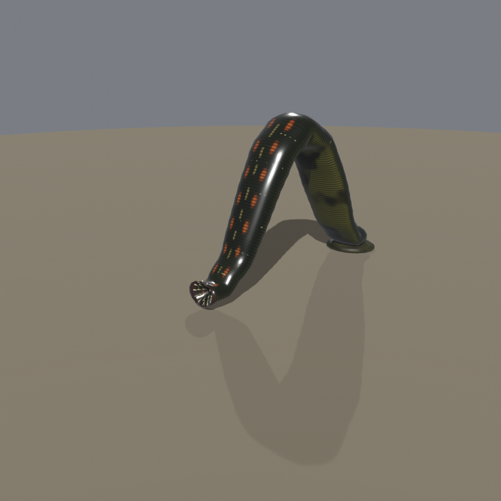

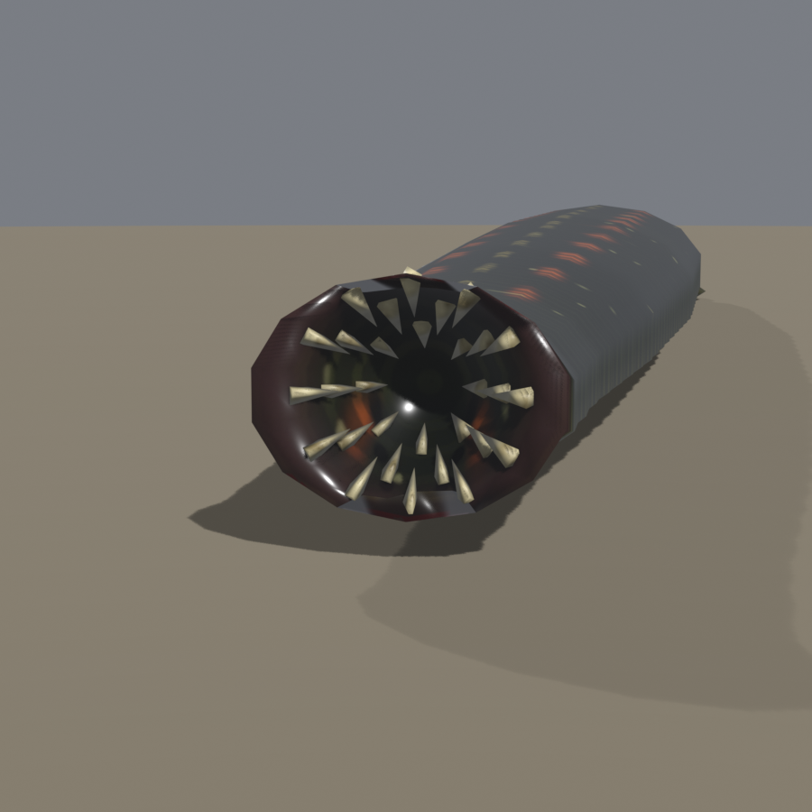

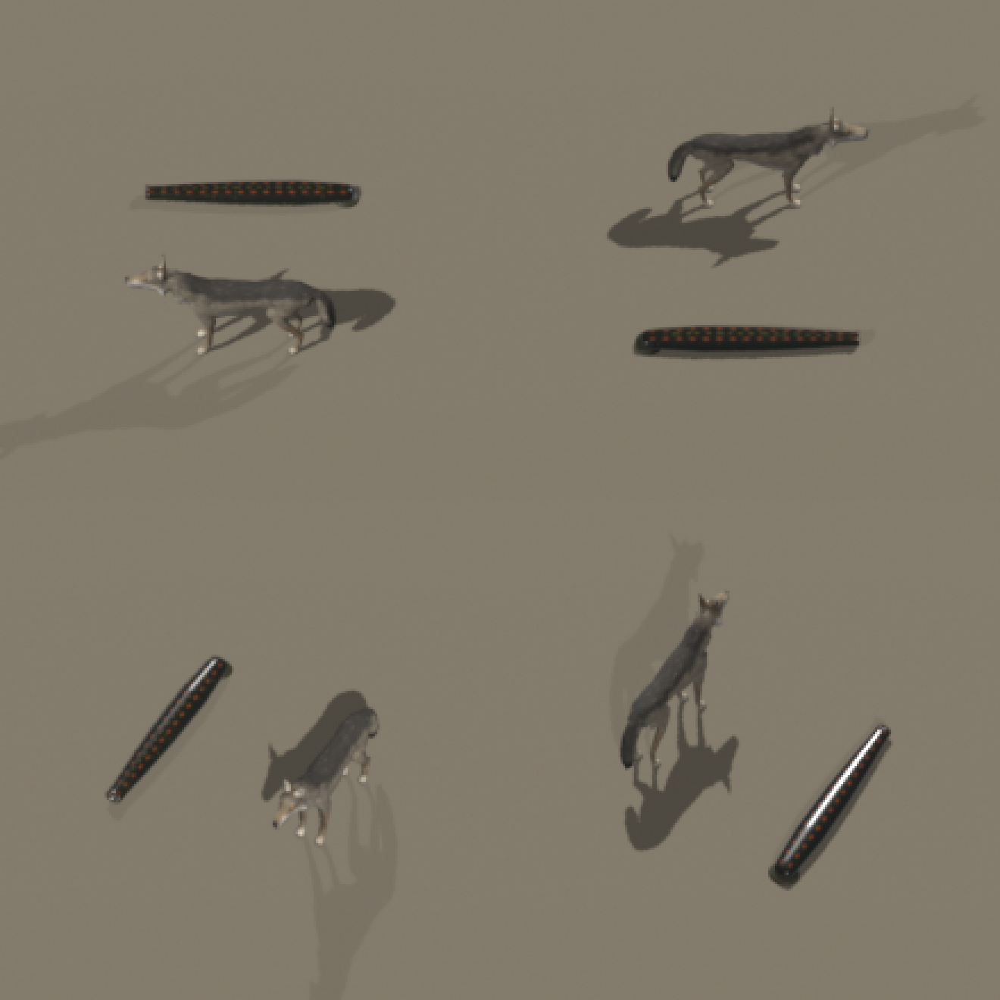

| Part | Triangles | Texture |
|---|---|---|
| The tube (rear cap, 71 rings of 14, the lip, the cup) | 2,128 | `T_Leech` 1024², A = smoothness (wet) |
| Teeth (30), rear sucker disc | 120, 128 | |
| **LeechBody** | **2,376** | `M_Leech` |

How it is built:

- **One clean tube, ring by ring** (`leech_body.build_tube`; no voxel fuse): a flattened section (the belly flatter),
  every other ring 3% fatter for the annuli, the front folding inward into the cup and a throat, the rear capped over
  the disc. Its faces are oriented by hand (the outside test, fooled by the cup folding inward, turned it inside
  out). Seams down the belly and round two rings: three short islands pack better than one 1.8 m strip.
- **A chain** (the ooze and the centipede are the other path bodies): Sucker, Body1-10, Head, rear to front, weights by
  arc length; a leaf **Swell<k>** on each body bone takes 60% of it (35% on the belly) and its uniform scale swells
  the segment. `beast_rig.apply_pose(scale_bones=...)` keys their scale (leaf bones only: no shear in Unity).
- **Poses are curves** (`leech_anim`): flat stretches on the ground, bell-shaped arches fitted to a length
  (`arch_fit`) and Beziers fitted to a length (`bezier_fit`); the bones sit at their rest arc positions scaled to the
  curve's length (it stretches and shrinks), framed by parallel transport from the rear, with a roll. The world curve
  is turned into the skeleton's frame once; Motion carries the root motion.

| Clip | Length | Notes |
|---|---|---|
| Idle | 3.0 s loop | lying stretched out, the front end raised and searching side to side, two pulses running down the body |
| Crawl | 2.0 s loop | looping like an inchworm: the rear sucker lets go and is drawn up behind the front one (the body arches ~0.45 m), then the front reaches forward; root motion 0.33 m/s |
| Lunge | 2.2 s | rears its front up and back, strikes 0.3 m past its head and latches on 0.4 m up (event `Bite` at 0.6 s), drinks (swellings run back from the mouth, the body pumps; events `Drain` 1.1 s, `Drain2` 1.5 s), lets go |
| Hit | 0.5 s | a writhe, the front recoiling |
| Death | 2.0 s | writhes, curls into a C on its side and shrinks; event `Dead` at 1.6 s; holds |

Lowest vertex: 2 mm above the ground in every clip but Death (-1.8 cm while it rolls onto its side). Crawl traced
over 3 loops: 0.65 m a loop, Motion's turn 0, the head's step at the seam 0.1 mm (inside the loop up to 13 mm: it
stops and goes). Export re-imported: 26 bones, one mesh, the Swell bones' scale keys kept.

Rebuild (headless, under a minute):

```
blender.exe -b --factory-startup --python tools/creature_run.py -- leech build review game clips lowest trace sheets closeups hero export
blender.exe -b --factory-startup blender/leech.blend --python tools/creature_run.py -- leech paint review
```

**In Unity:** copy the files (assets first, then the script) and run Tools > Beasts > Rebuild Leech
(`LeechSetup.cs`; it also runs by itself on the first import). It makes `M_Leech`, `Prefabs/Leech` (Animator,
`BeastAppearance` for the size, `BeastEvents`; bounds padded for the arch), `Animation/LeechAnims` and lineup renders
in `Logs/LeechSetup`. It touches no scene.

```
$B = "E:\Unity\Projects\GameArtGeneration\Beasts"; $U = "E:\Unity\Projects\MedievalSetting\Assets\Beasts"
Copy-Item "$B\export\Leech.fbx" "$U\Models\"
Copy-Item "$B\export\Anims\Leech@*.fbx" "$U\Models\Anims\"
Copy-Item "$B\export\Anims\leech_clips.json" "$U\Models\Anims\"
Copy-Item "$B\textures\T_Leech.png" "$U\Textures\"
Copy-Item "$B\unity\Beasts\Editor\LeechSetup.cs" "$U\Scripts\Editor\"
```

## Dragon and hydra

Two big creatures built on the same machinery as the beasts above. Each has its own .blend: `blender/dragon.blend`
and `blender/hydra.blend`.
- **The dragon:** six limbs, about 12 m long with a 16 m wingspan. Body ~30k tris, plus the wing membranes.
- **The hydra:** aquatic, with three heads (the dragon's head, made slimmer), no wings and no spikes. ~40k tris,
  plus the fins.

Both are painted at 4096 with three presets and normal maps.

| Dragon clip | Length | Notes |
|---|---|---|
| Idle / Walk / Run | 4.0 / 1.6 / 0.8 s loop | root motion 1.25 / 5.5 m/s |
| Bite, Claw, TailSweep | 1.4, 1.2, 1.8 s | event `Bite` |
| Fire | 2.5 s | `Fire` at 0.9 s, `FireEnd` at 2.0 s |
| Roar, Hit, Death | 2.2, 0.6, 3.0 s | `Roar` 0.6 s, `Dead` 2.0 s |
| Takeoff | 2.2 s | leaps (`TakeOff` 0.63 s) and climbs: 10 m forward, **7 m up** |
| Fly / Glide | 1.2 / 2.0 s loop | 10 / 14 m/s |
| Land | 2.4 s | 15.6 m forward, **7 m down**, `Land` at 1.4 s |

| Hydra clip | Length | Notes |
|---|---|---|
| Idle / Walk / Run | 4.0 / 1.33 / 0.67 s loop | root motion 1.0 / 3.9 m/s |
| Bite | 1.4 s | the middle head, `Bite` at 0.6 s |
| TripleBite | 2.4 s | left, middle, right: `Bite`, `Bite2`, `Bite3` at 0.6, 1.2, 1.8 s |
| TailSweep, Roar, Hit, Death | 1.8, 2.2, 0.6, 3.0 s | `Bite` 0.8 s, `Roar` 0.6 s, `Dead` 2.3 s |

**In Unity:**
- **Setup:** Tools > Beasts > Rebuild Dragon / Rebuild Hydra (`DragonSetup.cs`, `HydraSetup.cs`). Textures are imported
  at 2048. The wings and fins are drawn from both sides and always take the same preset as the hide
  (`BeastAppearance.pairedTarget`).
- **Flight:** Takeoff and Land keep their root motion's height. A pool marked `vertical` lets the random animator
  lift the creature, and the dragon's `Flight` pool plays Takeoff, Fly, Glide, Fly and Land in a row.
- **Fire:** `BeastBreath` breathes fire from `Socket_Mouth` between the Fire clip's events.
- **Test scene:** `Scenes/Dragons_Test` has two dragons and two hydras, with goblins for scale. Its viewer has wider
  presets and a follow camera.

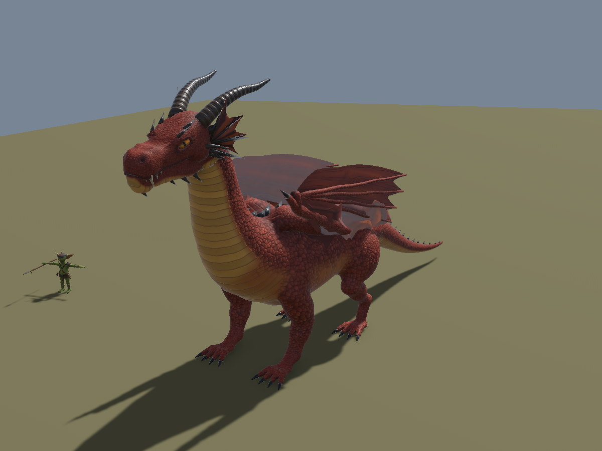
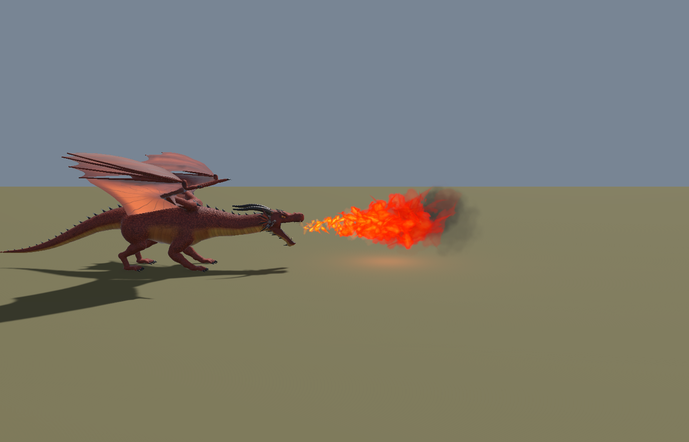
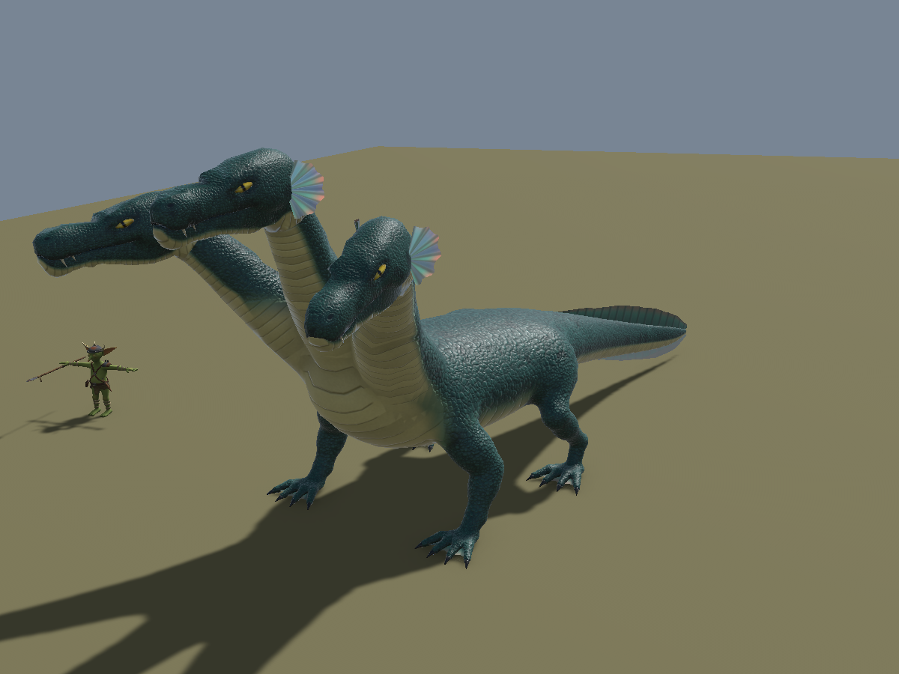

Export (in the live Blender, or headless when it is busy):

```python
import dragon_build; dragon_build.export()      # clips + Dragon.fbx + textures into export/
import hydra_build; hydra_build.export()
```
